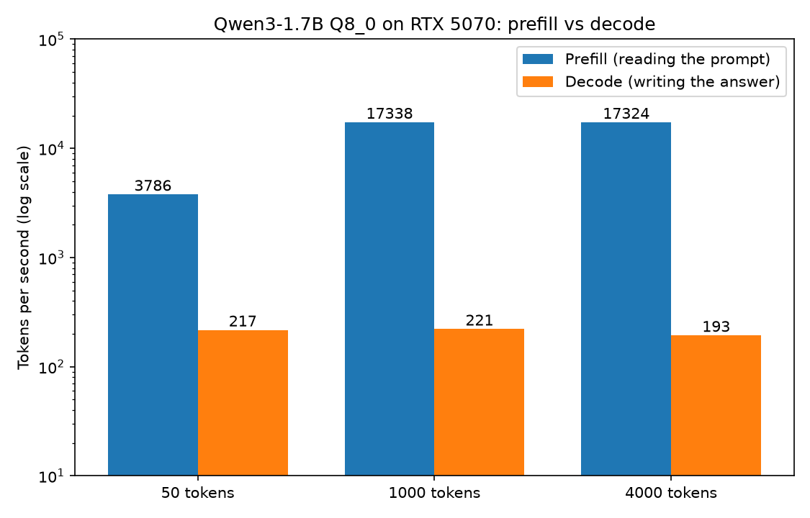
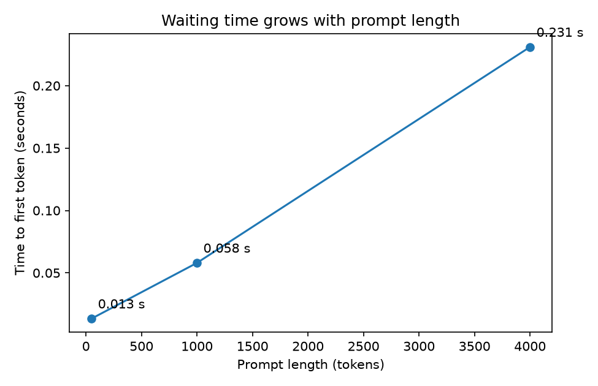

# Task 1: Run your first local model and time prefill vs. decode

## The question
When a language model answers, is reading my prompt the same kind of work as writing the answer? How different is the speed?

## What I did
- Ran Qwen3-1.7B (Q8_0 GGUF, 1.83 GB) with llama.cpp (build b11630, Windows CUDA), fully on an RTX 5070 with 12 GB (`-ngl 99 -c 8192`).
- Chatted with it in `llama-cli`, then served it with `llama-server` and timed it with `benchmark.py`.
- Sent prompts of 50, 1,000 and 4,000 tokens, 3 runs each, with the prompt cache off and exactly 128 generated tokens. Prompts are filler text trimmed to exact token counts and sent raw (no chat template). Time to first token is the server's reported prompt-processing time.
- `plot.py` makes the charts from `results/timings_raw.csv`.

## Results
| Prompt length | Prefill (reading) | Decode (writing) | Time to first token |
|---|---|---|---|
| 50 tokens | 3,786 tok/s | 217 tok/s | 0.013 s |
| 1,000 tokens | 17,339 tok/s | 221 tok/s | 0.058 s |
| 4,000 tokens | 17,324 tok/s | 193 tok/s | 0.231 s |





Reading the prompt is about 80x faster per token than writing the answer.

## Why prefill is faster per token than decode
Prefill handles every prompt token in one big batch of matrix multiplications, which keeps the GPU busy. Decode produces one token at a time, and each token needs all 1.83 GB of model weights read out of GPU memory. That makes decode limited by memory speed, not by compute. At this card's memory bandwidth the ceiling is roughly 245 tok/s, and I measured about 220.

The 50-token prefill is slower because fixed per-request overhead dominates a prompt that short. Decode slows to 193 tok/s at 4,000 tokens because each new token also has to look through a longer history.

## What went wrong along the way
- The default context made llama.cpp reserve a 4.5 GB KV cache and run out of GPU memory. Capping it with `-c 8192` fixed it.
- The old `huggingface_hub` command-line module no longer exists; the `hf` command replaced it.

## Caveats
One machine, one small model, 3 runs per data point, and filler text instead of a real article.

## Reproduce
```
hf download Qwen/Qwen3-1.7B-GGUF Qwen3-1.7B-Q8_0.gguf --local-dir $HOME\models
llama-server -m Qwen3-1.7B-Q8_0.gguf -ngl 99 -c 8192 --port 8080
python benchmark.py
python plot.py
```