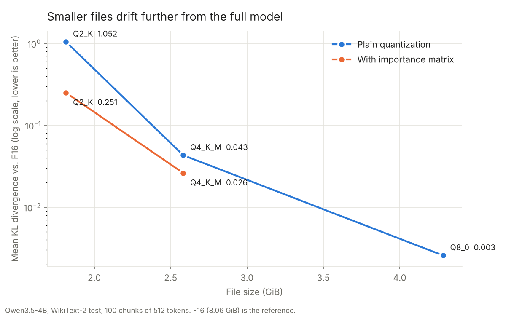
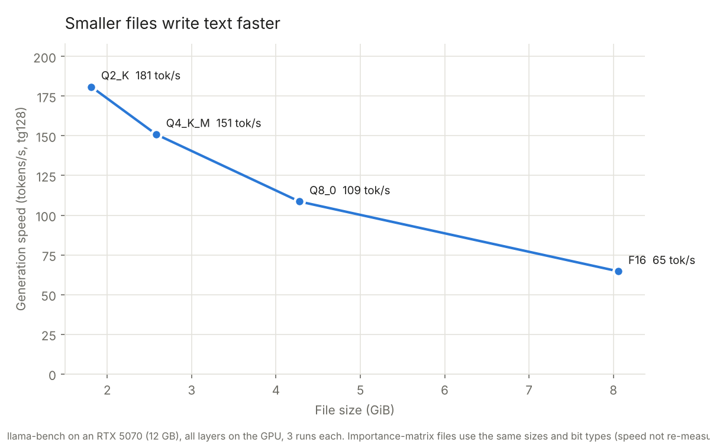

# Task 3: Quantize Qwen3.5-4B from 16 bits to 2 bits

**Finding:** Shrinking Qwen3.5-4B from 16 bits to 8 bits halves the file and costs nothing measurable. 4 bits costs a little. Plain 2-bit quantization breaks the model: its next-word guesses match the full model only 57% of the time. Building an importance matrix first cut that damage by 4x at the exact same file size.

## The question

What does quantization cost in quality, and what does it buy in file size and speed? And does an importance matrix (imatrix) help the low-bit versions?

## What I did

1. Downloaded `Qwen/Qwen3.5-4B` on Google Colab and converted it to a 16-bit GGUF with llama.cpp's `convert_hf_to_gguf.py`. My PC has only 8 GB of RAM. I then uploaded it to [huggingface.co/bbrihuang/Qwen3.5-4B-GGUF](https://huggingface.co/bbrihuang/Qwen3.5-4B-GGUF) and downloaded it to my PC. The vision encoder was left out because this task only needs text.
2. Made Q8_0, Q4_K_M and Q2_K versions with `llama-quantize`.
3. Measured speed with `llama-bench`: a 512-token prompt and 128 generated tokens, 3 runs each, all layers on the GPU.
4. Saved the F16 model's predictions on the WikiText-2 test set with `llama-perplexity --kl-divergence-base`. I used the first 100 chunks of 512 tokens; the full set would have made a 74 GB file. I then measured how far each smaller version's predictions drift from F16's (KL divergence).
5. Built an importance matrix with `llama-imatrix` on the WikiText-2 *training* text, so the test text stays unseen. I redid Q2_K and Q4_K_M with it and measured them again.

Hardware: Windows 11, RTX 5070 (12 GB), 8 GB RAM. llama.cpp build b11630 (CUDA).

## Results

| Version | Size | Bits per weight | Generation speed | Perplexity | Mean KL divergence | Same top token as F16 |
|---|---|---|---|---|---|---|
| F16 | 8,254 MiB | 16.0 | 64.6 tok/s | 9.74 | reference | 100% |
| Q8_0 | 4,387 MiB | 8.5 | 108.6 tok/s | 9.73 | 0.003 | 97.9% |
| Q4_K_M | 2,644 MiB | 5.1 | 150.9 tok/s | 10.16 | 0.043 | 90.8% |
| Q4_K_M + imatrix | 2,644 MiB | 5.1 | (same types) | **9.89** | **0.026** | **92.6%** |
| Q2_K | 1,858 MiB | 3.6 | 180.9 tok/s | 25.50 | 1.052 | 56.7% |
| Q2_K + imatrix | 1,858 MiB | 3.6 | (same types) | **11.93** | **0.251** | **77.3%** |





Raw numbers: [results/quality_kld.csv](results/quality_kld.csv) and [results/speed_llama_bench.csv](results/speed_llama_bench.csv).

## What I learned

- **8 bits is free and 2 bits is a cliff.** Quality loss is not proportional to bits removed. Going from 16 to 8 bits changed nothing measurable. Going from 5 to 3.6 bits multiplied the KL divergence by 24.
- **An importance matrix is the cheapest quality win there is.** It took about a minute to compute and costs zero extra bytes. Q2_K's KL divergence fell from 1.05 to 0.25, and Q4_K_M's fell by about 40%. Instead of spreading rounding error evenly, it puts the error on the weights that matter least for real text.
- **"Q2_K" is not really 2 bits.** It averages 3.6 bits per weight because llama.cpp keeps sensitive parts at higher precision. The token embedding table gets 6 bits, attention projections 4 bits, and FFN down-projections 3 bits.
- **Speed follows file size, but not perfectly.** Generating each token reads the whole model from GPU memory, so smaller files are faster, as Task 1 predicted. Q2_K is 4.4x smaller than F16 but only 2.8x faster, because unpacking 2-bit numbers costs extra work. F16 moved about 559 GB/s, which is close to the RTX 5070's 672 GB/s memory bandwidth.
- **Qwen3.5 is a hybrid model.** Only every 4th layer is normal attention. The rest are Gated DeltaNet layers (the `ssm_` tensors in the logs), which matters for Task 6.

## Problems hit

- The first `llama-bench` run ran out of GPU memory loading F16. It worked once other apps were closed.
- `llama-perplexity` with the default batch size crashed silently. Each batch holds scores for all 248,320 vocabulary tokens at every position, about 2 GB. `-b 512` fixed it.
- It then ran out of normal RAM (8 GB), until Docker Desktop, Chrome, Discord and games were closed.

## Caveats

- One model, one machine, and 100 chunks (about 51,000 tokens) of one dataset.
- The importance matrix came from WikiText training text and was tested on WikiText test text. Matching styles probably flatters the imatrix results somewhat.
- Prompt-reading speeds (pp512) varied a lot between runs (±300 to ±640 tok/s), so only generation speed is charted.
- The imatrix files' speed was not re-measured. They use the same bit types and sizes, so they should match the plain versions.

## Commands

```
# Colab (CPU runtime)
git clone --depth 1 --branch b11630 https://github.com/ggml-org/llama.cpp
hf download Qwen/Qwen3.5-4B --local-dir qwen35-4b
python llama.cpp/convert_hf_to_gguf.py qwen35-4b --outtype f16 --outfile Qwen3.5-4B-F16.gguf

# PC
llama-quantize Qwen3.5-4B-F16.gguf Qwen3.5-4B-Q2_K.gguf Q2_K        # also Q4_K_M, Q8_0
llama-bench -ngl 99 -r 3 -p 512 -n 128 -m <model>
llama-perplexity -m Qwen3.5-4B-F16.gguf -f wikitext-2-raw/wiki.test.raw -ngl 99 --chunks 100 -b 512 --kl-divergence-base f16_logits.kld
llama-perplexity -m <model> --kl-divergence-base f16_logits.kld --kl-divergence -ngl 99 -b 512
llama-imatrix -m Qwen3.5-4B-F16.gguf -f wikitext-2-raw/wiki.train.raw -o imatrix.gguf -ngl 99 --chunks 100 -b 512
llama-quantize --imatrix imatrix.gguf Qwen3.5-4B-F16.gguf Qwen3.5-4B-Q2_K-imat.gguf Q2_K
python plot.py
```
