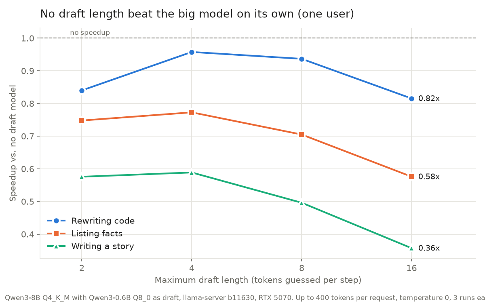
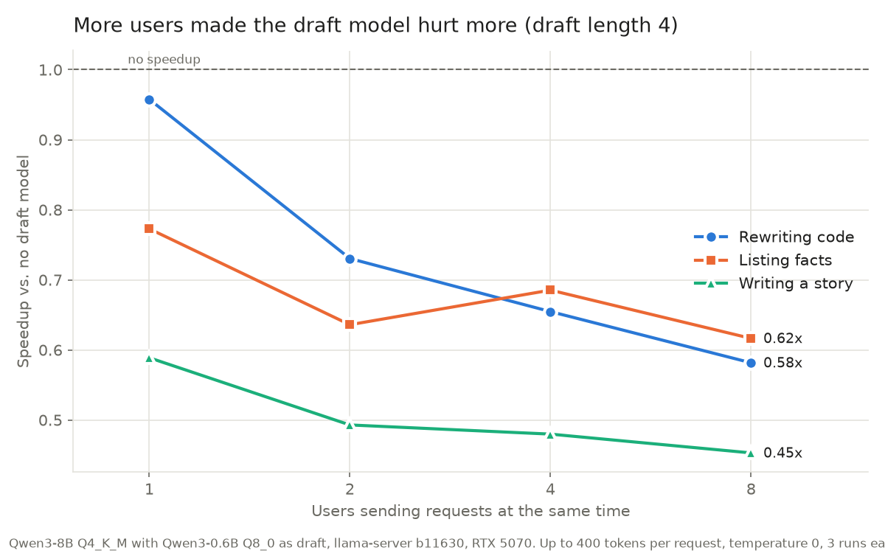

# Task 5: Speculative decoding with two Qwen models

**Finding:** On my RTX 5070, speculative decoding with Qwen3-0.6B as the draft for Qwen3-8B never made generation faster. The best case was rewriting code with 4 guesses per step, at 0.96x the speed of the big model alone. Writing a story ran at 0.59x. More users made it worse: with 8 users, total throughput fell to 0.45x to 0.62x. The guesses were good: up to 78% were accepted for code. The draft model was simply too expensive per guess on this fast GPU, and each guess-and-check step carried about 11 ms of extra overhead.

## The question

A big model writes one token per pass, and each pass reads all of its weights from GPU memory. Speculative decoding lets a small "draft" model guess the next few tokens. The big model then checks all of the guesses in a single pass, and every guess it accepts is a token that didn't need its own pass. Does that make Qwen3-8B faster on my GPU? When does it help, when does it hurt, and what changes when several users share the GPU?

## What I did

1. Downloaded Qwen3-8B (Q4_K_M, 5.03 GB) as the main model and Qwen3-0.6B (Q8_0, 639 MB) as the draft model. They share a tokenizer, which is required.
2. Wrote `spec_bench.py`. It starts `llama-server`, sends three kinds of prompts, records speed and how many guesses were accepted, and then stops the server. The prompts are rewriting a Python function, listing 25 planet facts, and writing a short story. Each prompt ran 3 times with up to 400 generated tokens at temperature 0.
3. With one user, ran no draft model first, then draft lengths 2, 4, 8 and 16.
4. With 2, 4 and 8 users sending the same prompt at once, ran no draft model and draft length 4. Each speedup compares against the no-draft run with the same number of users.
5. Timed each model on its own with `llama-bench` to find where the time goes.
6. Tried two fixes: stopping the draft once it is less than 70% sure (`--spec-draft-p-min 0.7`), and n-gram lookup, which guesses by copying earlier text and needs no draft model (`--spec-type ngram-simple`).

Hardware: Windows 11, RTX 5070 (12 GB), 8 GB RAM. llama.cpp build b11630 (CUDA).

## Results

**One user, by draft length.** Speed is in tokens per second. Speedup is against no draft model. "Accepted" is the share of guessed tokens the big model kept.

| Draft length | Code | Facts | Story |
|---|---|---|---|
| none | 99.9 tok/s | 105.5 tok/s | 107.9 tok/s |
| 2 | 0.84x (78% accepted) | 0.75x (66%) | 0.58x (45%) |
| 4 | **0.96x** (66%) | 0.77x (49%) | 0.59x (32%) |
| 8 | 0.94x (47%) | 0.70x (33%) | 0.50x (20%) |
| 16 | 0.82x (30%) | 0.58x (20%) | 0.36x (10%) |

**Several users, draft length 4.** The no-draft speed is total throughput across all users.

| Users | Code | Facts | Story |
|---|---|---|---|
| 1 | 0.96x (of 99.9 tok/s) | 0.77x (of 105.5) | 0.59x (of 107.9) |
| 2 | 0.73x (of 191.7) | 0.64x (of 202.0) | 0.49x (of 201.5) |
| 4 | 0.65x (of 283.3) | 0.69x (of 333.8) | 0.48x (of 333.3) |
| 8 | 0.58x (of 466.3) | 0.62x (of 531.8) | 0.45x (of 520.3) |

**Follow-up tests, one user.**

| Setting | Code | Facts | Story |
|---|---|---|---|
| Draft 4, stop when less than 70% sure | 0.92x (86% accepted) | 0.74x (82%) | 0.59x (77%) |
| N-gram lookup, no draft model | 1.03x | 1.02x | 1.00x |





Raw numbers: [results/runs.csv](results/runs.csv) has one row per request. Summaries are in [results/summary_draft_length.csv](results/summary_draft_length.csv), [results/summary_users.csv](results/summary_users.csv) and [results/summary_extra.csv](results/summary_extra.csv).

## Where the time goes

`llama-bench` timings for each model on its own, all layers on the GPU:

| | Time |
|---|---|
| Qwen3-8B, one token | 9.4 ms (106 tok/s) |
| Qwen3-8B, checking 5 tokens at once | 12.9 ms (388 tok/s) |
| Qwen3-0.6B, one guess | 2.1 ms (480 tok/s) |

Checking guesses really is cheap: 5 tokens cost only 1.4x as much as 1. The problem is the draft model. One guess takes 2.1 ms, about a fifth of a big-model step, so 4 guesses cost almost as much as the step they are meant to save. Adding it up, a step with 4 guesses should take about 8.4 + 12.9 = 21 ms, plus a little more for the draft model to catch up on the accepted tokens. The server log measured about 35 ms per step for both code and story. That leaves roughly 11 ms per step of coordination overhead that the math doesn't include.

For code, each step produced 3.63 tokens on average (from the server log), which works out to about 10 ms per token. That is a little slower than the 9.4 ms the big model needs alone. For the story, each step produced only 2.28 tokens, or about 15.5 ms per token.

## Why it works on paper, and why it didn't here

**Tokens per step.** If the big model accepts each guess with probability α, and the draft guesses γ tokens, each step produces on average (1 − α^(γ+1)) / (1 − α) tokens. That's Eq. 1 in Leviathan et al. The output is exactly what the big model would write on its own, so speculation changes the speed and never the text.

**The cost of guessing.** The paper's speedup is that number divided by (γc + 1), where c is the draft's time per token as a share of the big model's (Theorem 3.8). The paper's examples use drafts so small that c is close to 0. Here c is about 0.22. A 0.6B model doesn't get much faster than 2 ms per token on a GPU, because each token still runs 28 layers of small GPU jobs. Meanwhile, the big model is already fast because it's only 4.7 GB at 4 bits. For code at draft length 4, the server measured 3.63 tokens per step, so the formula predicts 3.63 / (4 × 0.22 + 1) ≈ 1.9x. That formula assumes checking 5 tokens costs no more than producing 1 (here it costs 1.4x) and leaves out overhead. With both included, the step takes about 35 ms instead of 9.4 ms, which brings 1.9x down to the measured 0.96x.

**Why predictable text did better.** The code rewrite repeats much of the prompt, so the small model guessed right more often: 78% at draft length 2, against 45% for the story. That ordering matched the theory. The story was the worst case at every setting.

**Why more users made it worse.** With one user, each step is limited by memory speed, and the GPU's arithmetic units sit mostly idle, so checking extra tokens is almost free. With 8 users batched together, that spare arithmetic is already busy producing other users' tokens. Every wasted guess now takes time someone else could have used, and the draft model's own passes add to every step. Without speculation, 8 users got 4.7x to 5.0x the throughput of one user. With speculation, 8 users got only 2.8x to 4.0x the throughput of one speculating user.

**Stopping early didn't help.** With a 70% confidence cut-off, the accepted share rose to 77% to 86%, but the speed stayed the same. Fewer wasted guesses weren't the fix, because the fixed cost of each step was the real problem.

**N-gram lookup did nothing.** The output reported no drafted tokens. With default settings it needs a 12-token exact match with earlier text before it will guess, and none of these prompts produced one. Its 1.00x to 1.03x is within run-to-run noise.

## What I learned

- **A speedup needs a draft that is far cheaper than the big model, not just smaller.** Qwen3-0.6B is 14x smaller than Qwen3-8B but only about 4.5x faster per token on this GPU. Speculative decoding pays off when the main model is slow per token: a bigger model, a slower GPU, or a model split across machines.
- **High acceptance isn't enough.** 86% of guesses were accepted in the cut-off test, and it was still slower than no speculation at all.
- **Measure the pieces.** The end-to-end speeds only said "slower". Timing each model on its own with `llama-bench` showed where the time went.
- **Speculation is a single-user trick.** Batching several users already uses the GPU's spare arithmetic, so speculation competes with them for it.

## Problems hit

- The server has to be running before you send it prompts. Running the server and the test in two PowerShell windows was easy to get wrong, so `spec_bench.py` now starts and stops the server itself.
- llama.cpp renamed its speculative decoding flags in 2026. `--draft-max` and `-cd` are gone, and `-md` on its own now loads the draft model and then quietly drops it. The working combination in b11630 is `-md <draft> --spec-type draft-simple --spec-draft-n-max N`. The script stops with an error if a draft run reports no drafted tokens, so a run that isn't really speculating can't be counted by mistake.
- With several users, `-c` is the context shared by all of them. A fixed `-c 8192` would have cut each of 8 users off at about 324 tokens, so the script uses `-c 1536×N`.

## Caveats

- One pair of models, one GPU, three prompts. Acceptance depends heavily on the prompt.
- The code prompt stopped by itself after about 168 tokens, while the others ran the full 400. Shorter answers carry more fixed overhead, which is why its no-draft speed (99.9 tok/s) is lower than the others'.
- Temperature 0 makes guessing easier than normal sampling, so real use would see lower acceptance.
- Multi-user runs send the same prompt from every user at once. Real traffic mixes prompt lengths and arrival times.
- Speed is tokens per second of wall time, including reading the prompt, so it is a little lower than the server's own generation speed.
- The n-gram test only used default settings. A shorter match length might find guesses in the code rewrite.

## Readings

- Leviathan, Kalman, Matias. [Fast Inference from Transformers via Speculative Decoding](https://arxiv.org/abs/2211.17192), sections 1 to 3.
- [LLM Inference Handbook: speculative decoding](https://handbook.modular.com/inference-optimization/speculative-decoding/) (BentoML, now hosted by Modular).
- Aleksa Gordić. [Inside vLLM: Anatomy of a High-Throughput LLM Inference System](https://vllm.ai/blog/2025-09-05-anatomy-of-vllm), the speculative decoding section.
- Agrawal et al. [On Evaluating Performance of LLM Inference Serving Systems](https://arxiv.org/abs/2507.09019), the speculative decoding case study.

Notes on each are in [notes/readings.md](notes/readings.md).

## Commands

```
cd C:\Users\brian\code\local-llm-lab\05-speculative-decoding
python spec_bench.py --sweep     # 11 settings, about 15 minutes
python spec_bench.py --extra     # confidence cut-off and n-gram lookup
python plot.py

llama-bench -m Qwen3-0.6B-Q8_0.gguf -ngl 99 -p 1,5 -n 32
llama-bench -m Qwen3-8B-Q4_K_M.gguf -ngl 99 -p 1,5 -n 32
```

The server command the script runs for each setting (N users, draft length K):

```
llama-server -m Qwen3-8B-Q4_K_M.gguf -ngl 99 -c <1536*N> -np <N> --cache-ram 0 --port 8080
             [-md Qwen3-0.6B-Q8_0.gguf -ngld 99 --spec-type draft-simple --spec-draft-n-max K]
```
