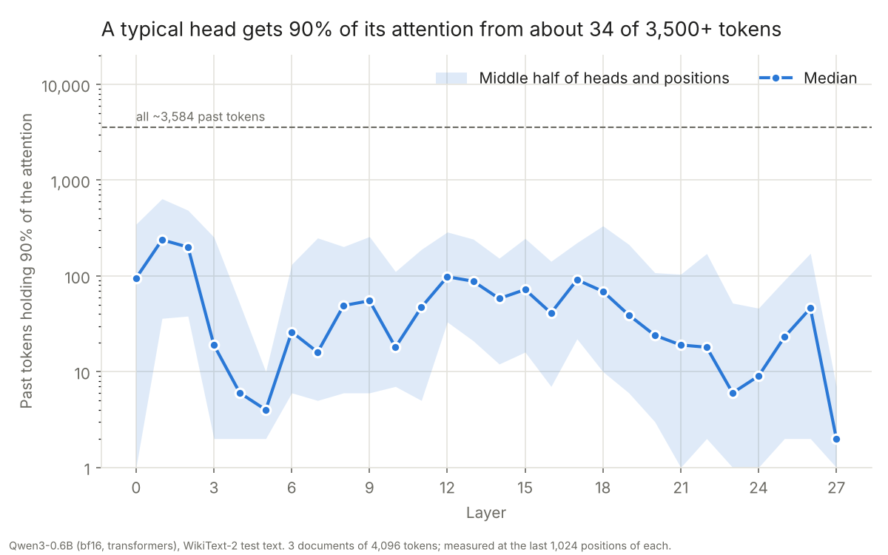
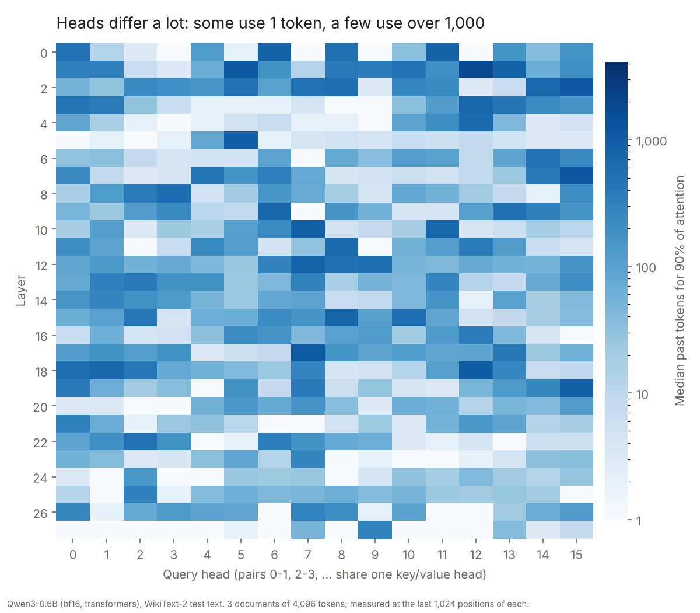
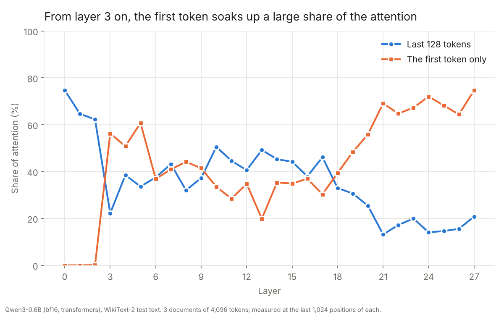

# Task 6: Types of attention

**Status:** the hands-on measurement is done by me. The reading notes and a slide draft on attention designs (MHA, GQA, MLA, sliding window, sparse, linear, FlashAttention) were written by Claude, so I still need to check and present them.

**Finding:** In Qwen3-0.6B, a typical attention head gets 90% of its attention from about 34 of the 3,500+ earlier tokens it could look at, which is under 1%. Much of that attention goes to a single place: from layer 3 on, the very first token of the text gets 20% to 75% of all attention, even though it's an ordinary word. The first token plus the most recent 128 tokens hold 62% to 95% of the attention in every layer. That pattern is why sliding-window attention that also keeps the first few tokens works well. The 5% to 38% left over, though, is spread thinly across thousands of tokens.

## The question

Full attention lets every token look at every earlier token. That costs memory (the KV cache grows with the text) and time (the work grows with the square of the length). Most newer attention designs bet that a model doesn't really need all of it. How much of the past does a real model actually use?

## What I did

1. Loaded Qwen3-0.6B in Hugging Face transformers on the GPU. Qwen3-0.6B has 28 layers, each with 16 query heads sharing 8 key/value heads (grouped-query attention).
2. Used the "eager" attention code, which is the textbook `softmax(QKᵀ/√d)·V`. It is the only one that builds the full attention table, so it can be inspected. Faster versions like FlashAttention compute the same result without ever storing the table.
3. Fed it three separate 4,096-token stretches of the WikiText-2 test set.
4. As each layer ran, `attention_span.py` grabbed its attention table. For each head and each of the last 1,024 positions, it did three things:
   - sorted the weights from biggest to smallest and counted how many tokens it takes to reach 90% (called **k90** below);
   - recorded the weight on the very first token;
   - recorded the weight on the most recent 128 tokens.

   Only the last 1,024 positions are measured, so every measured token has 3,072 to 4,095 tokens behind it.
5. `plot.py` drew the charts.

Hardware: Windows 11, RTX 5070 (12 GB). PyTorch 2.14.1 (CUDA 13.0), transformers 5.19.0.

## Results



**How many heads have a short reach.** Each head's k90 is its median over all measured positions. There are 448 heads in total.

| A head reaches 90% within... | Heads | Share |
|---|---|---|
| 1 token | 44 | 10% |
| 10 tokens | 152 | 34% |
| 32 tokens | 210 | 47% |
| 128 tokens | 323 | 72% |
| 512 tokens | 420 | 94% |
| 1,024 tokens | 444 | 99% |

Only 4 heads need more than 1,024 tokens. The widest is layer 1, head 12, which needs 1,792 tokens, about half the text. It gives almost nothing to the first token (0.1%) and only 9% to the last 128 tokens. It really does read broadly.



**Where the attention goes, by layer.**

| Layers | k90 (median) | First token | Last 128 tokens | First + last 128 |
|---|---|---|---|---|
| 0 to 2 | 95 to 238 | 0% | 62% to 75% | 62% to 75% |
| 3 to 5 | 4 to 19 | 51% to 61% | 22% to 39% | 79% to 94% |
| 6 to 19 | 16 to 98 | 20% to 48% | 31% to 51% | 69% to 84% |
| 20 to 27 | 2 to 46 | 56% to 75% | 13% to 25% | 80% to 95% |



Full per-layer numbers are in [results/per_layer.csv](results/per_layer.csv), and per-head numbers in [results/per_head.csv](results/per_head.csv). [results/k90.npz](results/k90.npz) has every measurement: layer × head × position.

## What it means

**Attention is sparse in practice.** Half of all measurements needed 32 tokens or fewer, and 91% needed 512 or fewer. A model that could find the right few dozen tokens would barely change its output. That is the idea behind trained-in sparse attention such as DeepSeek's NSA and DSA: a cheap scorer picks the top tokens, and full attention runs only on those.

**The first token is an "attention sink".** From layer 3 on, heads park a large share of their attention on token 0. In 8 heads it gets over 90%. Softmax forces each row of attention to add up to 1, so a head that has nothing useful to look at still has to put the weight somewhere. Qwen learned to dump it on the first position. It's about position, not content: in documents 2 and 3 the "first token" was a random word in the middle of an article, and it still got the same share (47% to 50% in layers 3 to 27 for all three documents). Xiao et al. called this an attention sink in the StreamingLLM paper, which is why their sliding-window method always keeps the first 4 tokens.

**A sliding window alone would break, but window + sink mostly works.** The last 128 tokens alone hold as little as 13% of the attention in the late layers. Adding the first token brings every layer to 62% to 95%. The rest is spread over thousands of tokens, which a window throws away. That's why models with sliding-window attention, like Gemma 3 and gpt-oss, still keep some full-attention layers. Qwen3.5 goes further: three out of every four layers use Gated DeltaNet, a linear attention with a fixed-size memory, and only every fourth layer uses full attention.

**Layers have jobs.** Layers 0 to 2 look at nearby words and ignore the first token, which fits building up meaning from local context. The last layers lean almost entirely on the sink plus a few tokens.

**Heads sharing a key/value head behave somewhat alike.** In grouped-query attention, query heads 0 and 1 share one set of keys and values, as do 2 and 3, and so on. Heads in the same pair differ in reach by about 4x on average. Neighboring heads in different pairs differ by about 7x. Sharing keys pushes heads toward similar patterns but doesn't make them the same.

## What I learned

- Reading the attention weights directly is easy with transformers' eager mode, but it only works because the model is small. One layer's table for 4,096 tokens and 16 heads is 16 × 4,096 × 4,096 numbers, about 1 GB in 32-bit floats. FlashAttention exists so that this table never has to be written to GPU memory.
- "Uses 1% of the context" doesn't mean "1% is enough." The leftover attention is small per token but spread across thousands of them, and some heads are genuinely long-range.
- The biggest single thing a head looks at is often a meaningless token. Any design that drops tokens has to keep it.

## Caveats

- One small model (0.6B) and one kind of text (Wikipedia articles). Larger models and other tasks, like retrieving a fact from a long document, may use more of the context.
- Reading text, not generating it. The measurement shows how the model attends while reading a document in one pass, which is the same computation it does at each generation step.
- k90 is a median over positions. Some positions need far more, which the shaded band in the first chart shows.
- 90% is an arbitrary cut-off. The `k50_median` column in `per_head.csv` gives the 50% version.

## Reading and slides (written by Claude, not by me)

- **Notes:** [notes/readings.md](notes/readings.md) covers Raschka's visual guide, the GQA paper, DeepSeek-V2, DeepSeek-V3.2 and V4, FlashAttention, Native Sparse Attention, Kimi Linear and the MiniMax post, with the key formulas, the numbers from each source, a comparison table and a section that ties my measurement to the designs (marked as inference). All sources were read through a tool that summarises pages, so figure values that exist only as plots are missing, and the notes say so. DeepSeek-V2's ablation tables were not readable (marked not verified).
- **Welch Labs video:** I have not watched it, and neither did Claude. The notes use the video's page and a third-party summary, and say so.
- **Slides:** [Attention Designs Compared](https://claude.ai/artifact/3wrsT6ASjB1VrXeD8Dx77u), 19 slides with speaker notes and the math for each design.
- **Mismatches the sources contain:** the FlashAttention text says 3x for GPT-2 while its table says 3.5x; the NSA paper gives both 260B and 270B training tokens; Kimi Linear's "6x decoding" is partly a batch-size effect (about 2.3x at batch size 1).

## Still to do

- Watch the Welch Labs video and read the DeepSeek-V2 ablation tables (Appendix D), then correct the notes where needed.
- Skim the slides, put the parts I will say in my own words, and present them.
- The V4 report's limitations section and a few Raschka figure values could not be read; check them against the originals before quoting.

## Commands

```
cd C:\Users\brian\code\local-llm-lab
python -m venv .venv
.\.venv\Scripts\python -m pip install torch --index-url https://download.pytorch.org/whl/cu130
.\.venv\Scripts\python -m pip install transformers numpy matplotlib

cd 06-attention-types
..\.venv\Scripts\python attention_span.py     # downloads Qwen3-0.6B the first time
..\.venv\Scripts\python plot.py
```

`attention_span.py` options: `--tokens` (document length, default 4096), `--docs` (default 3), `--last` (positions measured, default 1024), `--local` (window for the recent-tokens share, default 128), `--text` (path to the text file).
