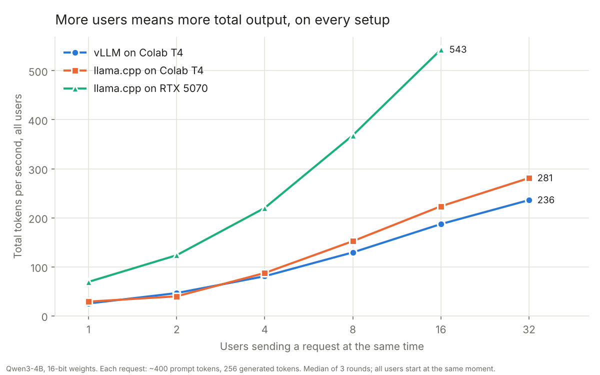
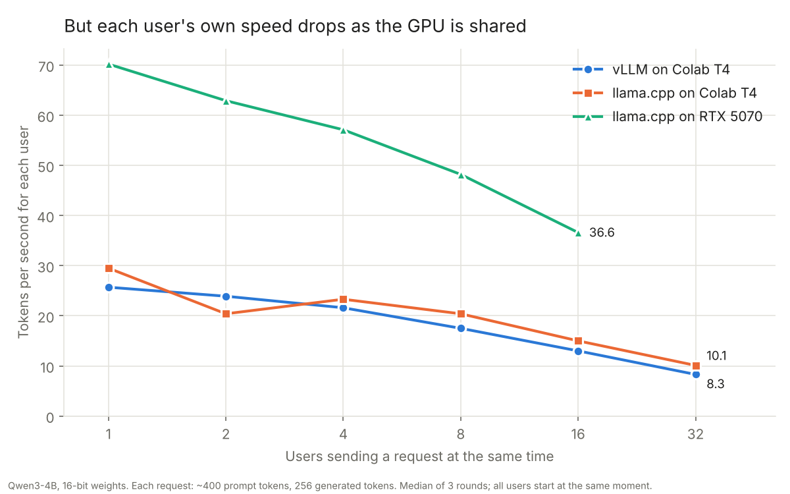
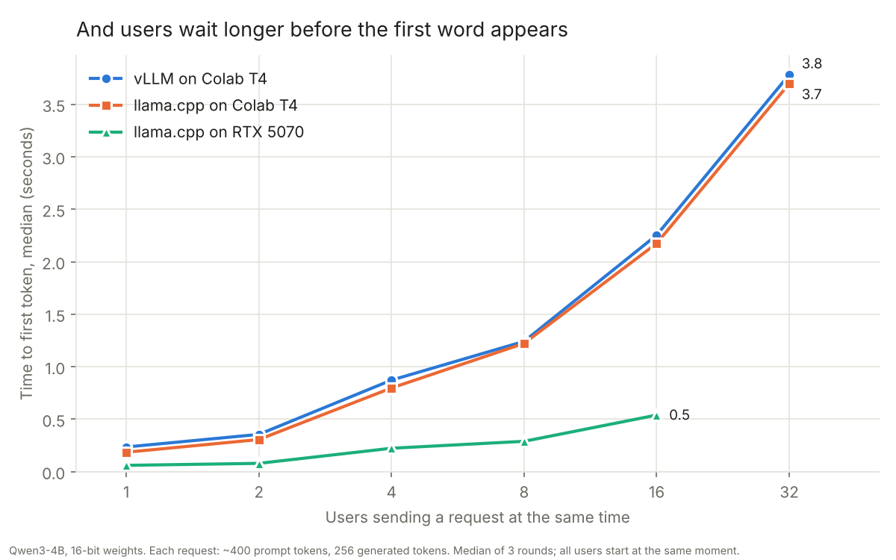

# Task 7: Inference engines

**Status:** the speed tests are done (by me). The five readings were done by Claude on 2026-10-17 (see `notes/readings.md`); I have not checked them against the sources myself.

**Finding:** On the same Colab T4 GPU, llama.cpp matched vLLM for 1 to 4 users and pulled ahead from 8 users on: 281 vs 236 tokens per second in total at 32 users, about 19% more. That is the opposite of vLLM's reputation as the engine built for many users. The most likely reason is the GPU: the T4 is too old for vLLM's fast attention code, so vLLM fell back to a slower version. vLLM was the steadier of the two, though. llama.cpp had a strange habit on both the T4 and my PC: at some user counts, its second round ran at about half speed, while the first and third were normal. vLLM never did this. On my PC, llama.cpp on the RTX 5070 was 2.4x to 3.1x faster than on the T4 (70 vs 29 tokens per second for one user, 543 vs 224 for 16).

## The question

An inference engine is the program that loads a model and serves it to users. llama.cpp is built to run anywhere, including laptops and gaming PCs. vLLM is built for data-center GPUs serving many users at once. Given the same model at the same precision, where does each one win, and why?

## What I did

1. Wrote `engine_bench.py`, one speed test that works against both engines through the same OpenAI-style `/v1/completions` endpoint. For 1, 2, 4, 8, 16 and 32 users it sends that many requests at the exact same moment, 3 rounds each, and records three things:
   - **time to first token**: how long a user waits before text starts appearing;
   - **speed per user**: tokens per second once a user's text is flowing;
   - **total speed**: all users' tokens divided by how long the round took.

   Each request has a ~400-token prompt and always generates exactly 256 tokens. Each prompt starts with a different request number, so neither engine can reuse work from an earlier prompt.
2. On a free Colab T4 (`colab_engines.ipynb`), served Qwen3-4B in 16-bit with vLLM, ran the test, then stopped vLLM and did the same with llama.cpp's `llama-server` on the same GPU. llama.cpp had to be compiled for the T4 first, which took about an hour on Colab's 2-core machine.
3. Converted the model to a 16-bit GGUF file for llama.cpp on Colab, uploaded it to [Hugging Face](https://huggingface.co/bbrihuang/Qwen3-4B-GGUF), and downloaded it to my PC. Doing the conversion on my PC wasn't an option with only 8 GB of RAM.
4. On my PC, `run_pc.py` started `llama-server`, ran the same test for 1 to 16 users, and stopped the server.
5. `plot.py` made the charts and `results/summary.csv`. Each number is the median of the 3 rounds, so one slow round doesn't drag down the result (see "llama.cpp's slow second rounds" below).

Both engines got the same model, Qwen3-4B, in 16-bit (vLLM in float16 because the T4 can't do bfloat16; llama.cpp from an F16 GGUF). Both used greedy decoding (temperature 0).

| | Colab | My PC |
|---|---|---|
| GPU | Tesla T4, 15 GB, ~320 GB/s memory | RTX 5070, 12 GB, ~672 GB/s memory |
| vLLM | 0.31.0 (PyTorch 2.13.0, CUDA 13.0) | not run |
| llama.cpp | build b11630, CUDA | build b11630, CUDA |
| Users tested | 1 to 32 | 1 to 16 (memory limit) |

## Results



**Colab T4, same GPU, both engines.** Time to first token and speed per user are medians over all requests; total speed is the median of the 3 rounds.

| Users | vLLM: first token | vLLM: per user | vLLM: total | llama.cpp: first token | llama.cpp: per user | llama.cpp: total |
|---|---|---|---|---|---|---|
| 1 | 0.24 s | 25.7 tok/s | 25.2 tok/s | 0.19 s | 29.5 tok/s | 29.0 tok/s |
| 2 | 0.36 s | 23.9 | 46.4 | 0.31 s | 20.4 | 39.8 |
| 4 | 0.87 s | 21.6 | 80.8 | 0.80 s | 23.3 | 87.4 |
| 8 | 1.24 s | 17.5 | 129.4 | 1.22 s | 20.4 | 152.3 |
| 16 | 2.25 s | 13.0 | 187.2 | 2.18 s | 15.0 | 223.5 |
| 32 | 3.78 s | 8.3 | **236.1** | 3.70 s | 10.1 | **281.0** |

**My PC, RTX 5070, llama.cpp.**

| Users | First token | Per user | Total | vs. llama.cpp on the T4 |
|---|---|---|---|---|
| 1 | 0.06 s | 70.2 tok/s | 69.3 tok/s | 2.4x |
| 2 | 0.08 s | 62.9 | 123.6 | 3.1x |
| 4 | 0.22 s | 57.1 | 220.1 | 2.5x |
| 8 | 0.29 s | 48.2 | 368.3 | 2.4x |
| 16 | 0.54 s | 36.6 | 543.1 | 2.4x |





`llama-bench` on the T4 for reference: reading a 512-token prompt ran at 2,591 tok/s, and generating ran at 30.6 tok/s.

Raw numbers: [results/runs.csv](results/runs.csv) has one row per request. [results/summary.csv](results/summary.csv) has one row per engine and user count, including each setup's best and worst round. The server logs are in [logs/](logs/).

## What it means

**One user is limited by memory speed, not by the engine.** To write each token, the GPU has to read all 8.05 GB of the model's weights. The T4 reads about 320 GB/s, so it can't go faster than about 40 tok/s; llama.cpp got 29.5 and vLLM 25.7. The RTX 5070 reads about 672 GB/s, a ceiling of about 83 tok/s, and llama.cpp got 70 (84% of it). This is why the PC is faster by roughly the ratio of the two cards' memory speeds.

**More users is almost free, up to a point.** The weights are read once per step no matter how many users are in the batch, so 16 users share one read. On the PC, total speed went from 69 to 543 tok/s (7.8x) while each user only slowed from 70 to 37 tok/s. Each user at 16 users on the PC was still faster than a single user alone on the T4.

**Why vLLM didn't win on the T4 (inferred from its log, not proven).** vLLM's advantages are paged KV cache memory, continuous batching, CUDA graphs and fast attention kernels. On the T4 its log says it chose the `TRITON_ATTN` attention backend because FlashAttention isn't available on this GPU generation (compute capability 7.5), and that its fast FlashInfer sampler was "unsupported" there too. llama.cpp's CUDA code has paths written for older cards. On a newer data-center GPU (A100, H100) with more users and longer outputs, vLLM's lead is well documented; this test couldn't show it.

**llama.cpp's slow second rounds.** Four times, a whole llama.cpp round ran at about half speed. Every user in that round got half the usual speed, while the time to first token stayed normal, so the decode steps themselves were taking about twice as long.

| Where | Users | Round 1 | Round 2 | Round 3 |
|---|---|---|---|---|
| Colab T4 | 8 | 152 tok/s | **79** | 154 |
| Colab T4 | 16 | 224 | **140** | 224 |
| RTX 5070 | 4 | 220 | **109** | 222 |
| RTX 5070 | 8 | 368 | **199** | 373 |

It was always the second round, never the first or third, and it happened on two different machines, so it isn't Colab being noisy. It didn't happen at every user count (not at 1, 2 or 32 users, and not at 16 on the PC). I didn't find the cause. My guess is that it has to do with which of llama-server's slots the new requests land in after the previous round, but that's untested. vLLM never did this: from 2 users up, its rounds were all within 1% of each other.

**Why users wait longer for the first word.** Both engines read prompts in chunks of about 2,048 tokens, which is about 5 of these prompts. At 16 users on the T4, the first words arrived in clumps about one second apart: at 0.25, 1.25, 2.25 and 3.24 s on vLLM, and at 0.20, 1.15, 2.18 and 3.13 s on llama.cpp. Each clump is one chunk of about 5 prompts, so the users at the back of the line wait for the chunks ahead of them. The engines behaved almost the same here. On the PC the same thing happens, just about 4x faster.

**Where each engine fits.** llama.cpp: one machine, any GPU (or none), a single file to download, quick to start (22 s on my PC, against several minutes for vLLM to compile and capture CUDA graphs on Colab). vLLM: a modern NVIDIA GPU serving many users, where its batching and memory management pay off, and where consistent latency matters.

## Caveats

- vLLM was only tested on an old GPU. I didn't run vLLM on my PC: it would need Docker or WSL, and 8 GB of RAM isn't enough to load an 8 GB model through them.
- MLX wasn't tested; it only runs on Apple Silicon Macs, and I don't have one.
- 400-token prompts and 256-token answers. Longer conversations would stress the KV cache more, which is where vLLM's paged memory is designed to help.
- 3 rounds per point. Medians hide llama.cpp's slow rounds in the charts, but a real user would sometimes hit one.

## Reading (done by Claude, not by me)
Claude read the five sources with a web tool that summarizes pages, so figures may be slightly off; items it could not find are marked "not found" in `notes/readings.md`. The notes link each source to my results and label every link as "the source says" or "a guess". Short version: the sources do not explain why llama.cpp beat vLLM at 32 users on the T4 (PagedAttention's gains show up with long sequences and memory pressure, which my short test avoids), nor the half-speed round 2. My 70 tok/s on the RTX 5070 near the memory limit fits the roofline idea in the vLLM post.

## Still to do
- Check the notes against the original sources, especially the PagedAttention evaluation sections that could not be fetched.
- Look into the half-speed round 2 on both machines.

## Commands

On Colab (GPU runtime, T4): run the cells of `colab_engines.ipynb` in order. It installs vLLM, downloads Qwen3-4B, runs the test against vLLM, builds llama.cpp, converts the model to GGUF, runs the test against llama.cpp, and uploads the GGUF to Hugging Face.

On my PC:

```
cd C:\Users\brian\code\local-llm-lab
.\.venv\Scripts\hf download bbrihuang/Qwen3-4B-GGUF Qwen3-4B-F16.gguf --local-dir C:\Users\brian\models

cd 07-inference-engines
..\.venv\Scripts\python run_pc.py
..\.venv\Scripts\python plot.py
```

`engine_bench.py` works against any OpenAI-style server: `python engine_bench.py --url http://127.0.0.1:8080 --engine llama.cpp --hardware "RTX 5070"`. Options: `--users`, `--rounds`, `--max-tokens`, `--prompt-words`, `--model` (vLLM needs the served model's name).
