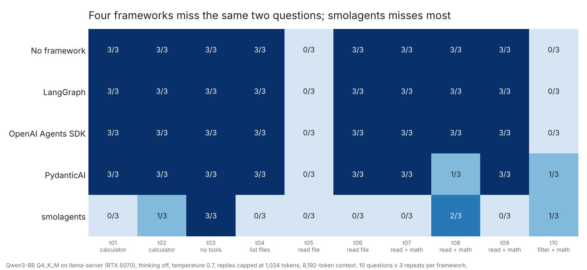
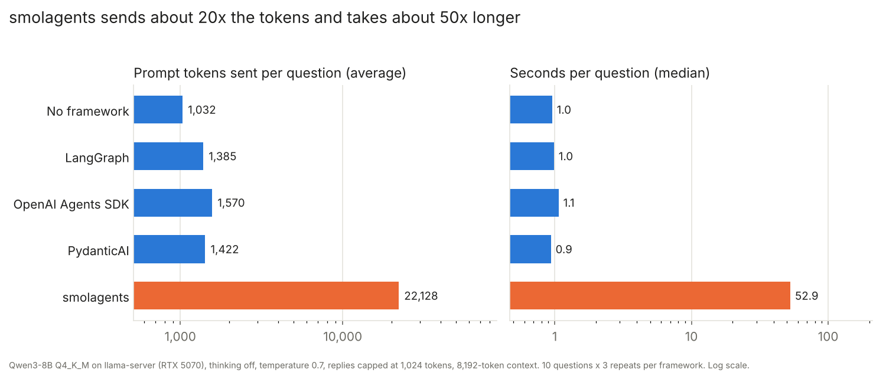

# Task 7.5: Comparing agent frameworks

**Finding:** With the same local model, tools and questions, four of the five setups gave almost the same results: no framework, LangGraph, the OpenAI Agents SDK and PydanticAI each got 23 or 24 of 30 answers right in about one second per question. All four missed the same two questions almost every time, so the mistakes came from the model, not the framework. Where the frameworks differed was overhead: they sent 34% to 52% more prompt tokens than a hand-written loop. In exchange, the agent took 9 or 10 lines of code instead of 30. The fifth, smolagents, got only 7 of 30 right with Qwen3-8B. Its long built-in instructions teach the model to write tool calls as text, and the model wrote one, kept going, and filled up its memory. It sent about 20 times the tokens and took about 50 times longer per question.

## The question

An "agent" is a loop: the model reads a question, asks for a tool (a calculator, a file reader), gets the result back, and repeats until it can answer. Frameworks like LangGraph, smolagents, the OpenAI Agents SDK and PydanticAI write that loop for you. Do they change how well a small local model does, how fast it is, or how much work it has to do?

## What I did

1. Gave every agent the same three tools, written once in `tasks.py`: `calculator`, `list_files` and `read_file`. The `data/` folder holds three small files made from my own earlier results: Task 3's quantization numbers, Task 7's engine numbers, and GPU notes.
2. Wrote 10 questions with checkable answers. They range from plain arithmetic to "read a CSV, pick the right rows, add them up". One needs no tools at all, to see whether the agent calls tools anyway.
3. Wrote the same agent five ways, one file each: `agent_plain.py` (the loop by hand with the `openai` client), `agent_langgraph.py`, `agent_smolagents.py`, `agent_openai_agents.py` and `agent_pydantic_ai.py`. Each uses the framework's default agent, with no tuning.
4. `bench.py` starts `llama-server` with Qwen3-8B (Q4_K_M) and puts a small counting proxy between the agents and the server. The proxy does two jobs:
   - it counts every request and token, whatever framework sent it;
   - it gives every request the same settings: temperature 0.7, thinking off, and at most 1,024 tokens per reply.
5. Each framework answered all 10 questions 3 times. The automatic check looks for the right number or word in the answer. I checked the answers by hand too and re-scored 2 of 150 (listed in `results/audit.csv`).
6. `plot.py` made the charts and `results/summary.csv`.

Hardware: Windows 11, RTX 5070 (12 GB), 8 GB RAM. llama.cpp b11630. Versions: openai 3.31.0, langgraph 1.2.15, langchain-openai 1.7.2, smolagents 1.26.0, openai-agents 0.24.0, pydantic-ai-slim 2.56.0.

## Results

| | Lines of code | Correct | Errors | Seconds per question (median) | Model requests per question | Prompt tokens per question | Tokens per request, no-tools question |
|---|---|---|---|---|---|---|---|
| No framework | 30 | 24/30 | 0 | 1.0 | 2.4 | 1,032 | 303 |
| LangGraph | 9 | 24/30 | 0 | 1.0 | 2.7 | 1,385 | 376 |
| OpenAI Agents SDK | 10 | 24/30 | 0 | 1.1 | 2.8 | 1,570 | 424 |
| PydanticAI | 9 | 23/30 | 0 | 0.9 | 2.7 | 1,422 | 384 |
| smolagents | 7 | 7/30 | 21 | 52.9 | 6.1 | 22,128 | 3,107 |

The last column comes from the question that needs no tools. For the first four it's a single request, so it shows each framework's fixed overhead: instructions plus tool descriptions. smolagents made 4 requests even for that question, averaging about 3,100 tokens each.





Every request and answer: [results/runs.csv](results/runs.csv). Totals: [results/summary.csv](results/summary.csv).

## What it means

**For the four that use the model's built-in tool calling, the framework hardly mattered.** All four got question 5 wrong in every run, and question 10 wrong in 11 of their 12 runs, the same way:
- Question 5 asks which format generated tokens fastest. The model read the `generation_tok_s` column as a time ("64.6 seconds"), so it picked the slowest format, F16.
- Question 10 asks for the sizes of the rows with KL divergence below 0.05. The model added up every row (21.12 instead of 17.5). The one exception was a PydanticAI run where the calculator call failed and the model went through the rows by hand instead.

Those are the model's mistakes, and a framework can't fix them. Swapping frameworks changed the score by at most one question out of 30.

**Frameworks cost tokens, not time.** Their fixed overhead is 73 to 121 tokens more than the hand-written loop, because they send each tool's full description. On questions 8 to 10 they also usually made one more tool call than the plain loop. Altogether that's 34% to 52% more prompt tokens per question. On a local GPU that reads prompts at thousands of tokens per second, it made no difference to speed. With a paid API it would be 34% to 52% more on the bill for prompts.

**The tool description is part of the prompt.** PydanticAI got question 8 wrong twice, answering 8,347.8 instead of 83.5. That's exactly 100 times too big. The calculator's description includes the example `"(150.9 / 64.6) * 100"`, and the frameworks pass that description to the model word for word. My hand-written loop used a shorter one-line description. I think the model copied the `* 100` from the example, but that's a guess.

**smolagents didn't work with this model.** By default, smolagents's tool-calling agent sends long instructions with examples of tool calls written as text ("Action: {…}"), and it forces a tool call on every step (`tool_choice="required"`). Qwen3-8B answered by writing the tool call as text and then not stopping. In one run it wrote "Have a great day! 🌟" until it ran out of room. After the 1,024-token cap, every step still ended in a long reply. Those replies piled up in the conversation until it no longer fit in the 8,192-token context: 21 of its 30 runs ended that way. smolagents is built around bigger models and its own "code agent" style. This only shows that its default tool-calling agent and Qwen3-8B on llama.cpp don't get along.

**What each framework is like to use** (my impressions from writing the five files):
- **No framework:** you write the tool schemas by hand and handle every message yourself. It's the most code, but you can see exactly what the model gets.
- **LangGraph:** `create_react_agent` takes plain Python functions and works in one call. The full LangGraph is a graph library, so it's the one to reach for when the flow gets more complicated than a loop.
- **OpenAI Agents SDK:** needs three extra settings to work with a local server: chat-completions mode, its own client, and tracing turned off, because it otherwise tries to upload traces to OpenAI.
- **PydanticAI:** the least setup; plain functions become tools. It printed an advertising banner until I turned it off with an environment variable.
- **smolagents:** the fewest lines, but the default agent didn't work with this model.

## Problems hit

- **The first full run froze my PC.** The screen went black partway through and I had to hold the power button. Windows logged only an unexpected shutdown, with no blue screen and no graphics driver error. That usually means a hard freeze, most likely the graphics driver. The cause isn't proven. I turned off llama.cpp's CUDA graphs (`GGML_CUDA_DISABLE_GRAPHS=1`, now the default in `bench.py`), cut the context from 16,384 to 8,192 tokens, and ran one framework at a time. It didn't happen again.
- **smolagents's first question took 85 seconds** because of the "Have a great day!" loop, so I added the 1,024-token cap on every reply. It applies to all five frameworks, and the other four were re-run with it.
- One smolagents run took 703 seconds. I don't know why; it's left in the data and the median isn't affected.

## Caveats

- One small model (Qwen3-8B, 4-bit) with thinking turned off. A bigger model, or Qwen3 with thinking on, might do better on questions 5 and 10, and might get along with smolagents.
- 10 questions, 3 repeats each. Differences of one or two questions between frameworks are noise.
- Each framework used its default agent. All of them, smolagents especially, can be tuned, for example with a shorter system prompt, `tool_choice="auto"`, or smolagents's `CodeAgent`.
- The automatic check is lenient: it accepts an answer that contains the right number or word anywhere. That's why 2 answers were re-scored by hand.

## Commands

```
cd C:\Users\brian\code\local-llm-lab\07.5-agent-frameworks
..\.venv\Scripts\python -m pip install -r requirements.txt

..\.venv\Scripts\python bench.py --frameworks plain
..\.venv\Scripts\python bench.py --frameworks langgraph
..\.venv\Scripts\python bench.py --frameworks smolagents
..\.venv\Scripts\python bench.py --frameworks openai_agents
..\.venv\Scripts\python bench.py --frameworks pydantic_ai
..\.venv\Scripts\python plot.py
```

`bench.py` options: `--frameworks`, `--tasks` (for example `t01,t05`), `--repeats` (default 3), `--ctx` (context size, default 8192), `--cuda-graphs` (turn CUDA graphs back on), `--no-server` (use a llama-server that's already running on port 8080). Re-running a framework replaces its rows in `results/runs.csv`.
