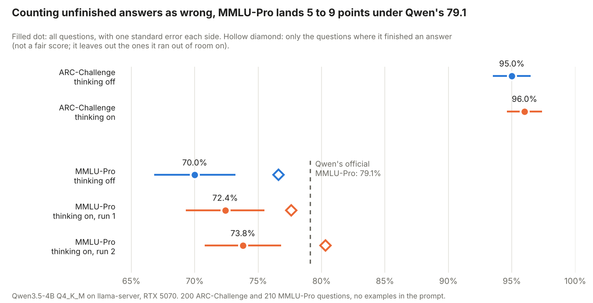
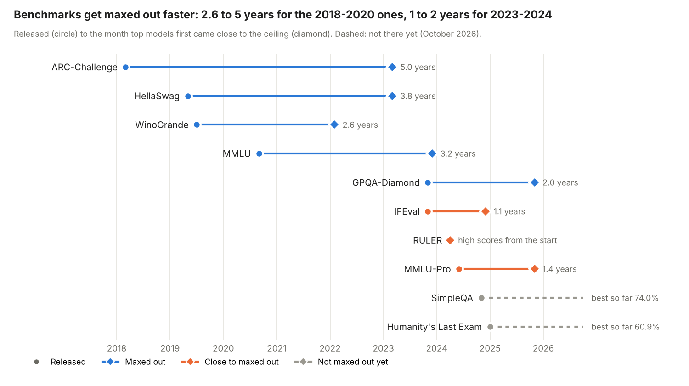

# Task 8: Research benchmarks (language understanding and knowledge)

**Finding:** I ran Qwen3.5-4B (Q4_K_M, on my RTX 5070) through the two benchmarks the task asks for. On ARC-Challenge it scored 95.0% with thinking off and 96.0% with thinking on. On MMLU-Pro it scored 70.0% off and 72.4% and 73.8% on (two runs), against Qwen's published 79.1%. Part of that gap is not wrong answers: 14 to 18 of the 210 MMLU-Pro replies were cut off before the model gave a final answer, and I count those as wrong. Among only the questions it finished, it scored 76.6% to 80.3%. That is an upper bound, not a fair score, but it shows the model is close to Qwen's number and the rest is mostly my token limit and noise of about 3 points. Looking at all ten benchmarks: the three oldest (2018 to 2019) took 2.6 to 5 years to max out, and the ones from 2023 to 2024 took 1 to 2 years or are already close.

## The question

A benchmark score is only useful if you know what the test asks, how it is scored, and how far it is from being maxed out. What do the ten common knowledge and language benchmarks really look like, how fast did they fill up, and how does a small local model do on them?

## What I did

1. **Tried the questions.** `sample_questions.py` picked 3 real questions from each of MMLU, MMLU-Pro, GPQA-Diamond, Humanity's Last Exam (HLE), ARC-Challenge, HellaSwag, WinoGrande, SimpleQA, IFEval and RULER (30 questions). `ask_model.py` asked Qwen3.5-4B Q4_K_M all 30 with thinking off and then on. I checked the free-text ones by hand (SimpleQA, HLE, and a few others), listed in `results/hand_checks.csv`. `quiz.py` lets me answer the same questions myself; I haven't done that yet (see "Still open").
2. **Ran lm-evaluation-harness** (0.4.13, `local-chat-completions` against `llama-server`, 4 requests at a time). `run_harness.py` starts the server, runs the harness and stops the server. The tasks are in `tasks/`: 200 ARC-Challenge questions, and 15 MMLU-Pro questions from each of 14 subjects (210). The prompt has no examples and ends with "The answer is (X)"; the last match counts. Unanswered replies count as wrong. Sampling follows Qwen's settings: instant temperature 0.7, top-p 0.8; thinking temperature 1.0, top-p 0.95; both top-k 20 and presence penalty 1.5. In the harness, replies are capped at 4,096 tokens with thinking off and 14,000 with thinking on.
3. **Researched all ten benchmarks** (`data/benchmarks.csv`, with links in `data/benchmarks_sources.md`): when released, who made it, what it tests, how it is scored, human baseline, best score, and when it was maxed out. `timeline.py` drew the chart.
4. **Wrote one card per benchmark**: [cards.md](cards.md).
5. `analyze.py` made the summary tables and `results/harness_scores.png`.

Hardware: Windows 11, RTX 5070 (12 GB), 8 GB RAM. llama.cpp b11630, lm-eval 0.4.13. Model: Qwen3.5-4B Q4_K_M.

## Results

### The harness runs

| Benchmark | Setting | Questions | Right | Score | Std. error | No final answer | Score counting only finished answers |
|---|---|---|---|---|---|---|---|
| ARC-Challenge | thinking off | 200 | 190 | 95.0% | 1.5 | 0 | 95.0% |
| ARC-Challenge | thinking on | 200 | 192 | 96.0% | 1.4 | 0 | 96.0% |
| MMLU-Pro | thinking off | 210 | 147 | 70.0% | 3.2 | 18 | 76.6% |
| MMLU-Pro | thinking on, run 1 | 210 | 152 | 72.4% | 3.1 | 14 | 77.6% |
| MMLU-Pro | thinking on, run 2 | 210 | 155 | 73.8% | 3.0 | 17 | 80.3% |

Qwen's model card lists **79.1%** for MMLU-Pro. Standard error is sqrt(p(1-p)/(n-1)).



Per-subject MMLU-Pro scores are in [results/mmlu_pro_by_subject.csv](results/mmlu_pro_by_subject.csv). With only 15 questions per subject, one question is 6.7 points, so I wouldn't read much into them. The only clear pattern across all three runs is that math was the best (93% each time) and law the worst (40%, 27%, 20%).

### My 30 questions (3 per benchmark)

| Benchmark | Thinking off (of 3) | Thinking on (of 3) |
|---|---|---|
| MMLU | 2 | 2 |
| MMLU-Pro | 3 | 3 |
| GPQA-Diamond | 2 | 3 |
| Humanity's Last Exam | 1 | 0 (+2 still to be judged) |
| ARC-Challenge | 3 | 3 |
| HellaSwag | 2 | 3 |
| WinoGrande | 3 | 3 |
| SimpleQA | 1 | 0 |
| IFEval | 1 | 3 |
| RULER | 3 | 3 |
| **Total** | **21 / 30** | **23 / 30** |

Full table: [results/own_questions_summary.csv](results/own_questions_summary.csv). The questions and the model's replies for GPQA and HLE are not published; those two datasets ask people not to post their questions online. `questions/` is gitignored for the same reason.

### Timeline



| Benchmark | Released | Maxed out | Years to max out |
|---|---|---|---|
| ARC-Challenge | 2018-03 | 2023-03 | 5.0 |
| HellaSwag | 2019-05 | 2023-03 | 3.8 |
| MMLU | 2020-09 | 2023-12 | 3.3 |
| WinoGrande | 2019-07 | 2022-02 | 2.6 |
| GPQA-Diamond | 2023-11 | 2025-11 | 2.0 |
| MMLU-Pro | 2024-06 | 2025-11 (near) | 1.4 |
| IFEval | 2023-11 | 2024-12 (near) | 1.1 |
| RULER | 2024-04 | 2024-04 (near) | about 0 |
| SimpleQA | 2024-11 | not yet | |
| HLE | 2025-01 | not yet | |

"Maxed out" means a model matched the human baseline, or scored within a few points of the highest score that is possible, given label errors. I used the first date I could find for that. Where the dataset has no human baseline, I used the first 90%+ score, and I marked those "near".

## What it means

**The gap to Qwen's 79.1% is mostly unfinished answers plus noise.** My harness scores are 5 to 9 points under it, and the standard error on 210 questions is about 3 points. In each run, 14 to 18 of the 210 replies ended before the model wrote "The answer is (X)", and those count as wrong. Without them, the scores are 76.6% to 80.3%. I'm not claiming that's the fair score, since the cut-off questions are probably the hard ones. What I take from it is that the model is probably close to Qwen's number, and that how you handle long replies moves the score by several points. Also: Qwen's model card doesn't say whether its 79.1% was measured with thinking on or off. I first thought it was thinking on, but the card doesn't say so.

**Thinking helped less than I expected.** On MMLU-Pro, thinking on beat thinking off by 2.4 and 3.8 points. That's inside the noise: my two thinking runs, with identical settings, differed by 1.4 points by themselves. On ARC-Challenge the gap was 1 point (2 questions). It cost a lot, though: ARC took about 35 minutes with thinking on and MMLU-Pro about 111 minutes.

**ARC-Challenge is easy now.** 95% to 96% for a 4-billion-parameter model on a laptop-sized GPU matches the best results from 2023 to 2024 (GPT-4 96.3%, Claude 3 Opus 96.4%). That fits the timeline: it was released first and took longest, but is now maxed out.

**My 30 questions only show a few things.** With 3 per benchmark, a 2-versus-3 difference means nothing. The two clear results: SimpleQA was 1 of 3 off and 0 of 3 on, and the wrong answers were confident made-up facts (a name, a number of songs, a year). That matches what SimpleQA is built to test, which is factual recall, and a 4B model doesn't have the memory for it. One SimpleQA question with thinking on used the whole 20,000-token budget without ever giving an answer, and one HLE question with thinking off ran out of its 4,096 tokens.

**Benchmarks fill up faster now.** The 2018 to 2020 ones took 2.6 to 5 years. The 2023 to 2024 ones took 1 to 2 years or are already near the top. The two that still have room, HLE and SimpleQA, are the newest, and SimpleQA's room mostly disappears if the model can search the web (90% to 97% with search).

## Problems hit

- **GPQA and HLE are gated.** I had to run `hf auth login` and accept their terms on Hugging Face first.
- **WinoGrande crashed `sample_questions.py`** with a `KeyError: 'qID'`: the copy I could download has no question IDs. Fixed by making up an ID from the row number.
- **Some replies ran out of room.** That is the "no final answer" column above. It happened in all three MMLU-Pro settings (14 to 18 of 210), so the 4,096 and 14,000-token caps both cost points. I didn't test higher caps, so I don't know how many of those would have been right.
- **Re-downloaded zip.** My browser saved the second download as `(1)`, so the old files got extracted. I now delete the old zip before downloading.

## Caveats

- **The cut-off replies matter.** The "only finished answers" column is not a fair score; it's an upper bound.
- **Subsets, not full benchmarks.** 200 ARC-Challenge and 210 MMLU-Pro questions, not all 1,172 and 12,032. The official number uses all of them, with its own prompt, so even with no cut-offs I wouldn't expect an exact match.
- **Q4_K_M is a 4-bit compression** of the model, which costs a little accuracy compared to Qwen's full-precision numbers (Task 3 measured about 0.4 perplexity points on WikiText-2).
- **Top scores come from many places.** Several of the "best score" numbers in the cards are reported by the company that made the model, not independently checked. Cards mark which are which. The 96.0% for GPQA-Diamond and the 74.0% for SimpleQA are self-reported, and some aggregator sites list scores I couldn't confirm; the data file marks those "unconfirmed".
- **Hand-checking is my judgement.** A few free-text answers (listed in `results/hand_checks.csv`) were marked by me, not a program. Two HLE answers with thinking on are still unjudged.

## Still open

- **Quiz.** `quiz.py` so I can answer the same 30 questions and compare with the model. Not done yet.
- **Two HLE answers** (thinking on) need my judgement: `python quiz.py --model-answers`.
- **Readings**: done by Claude, not by me, on 2026-10-17 (`notes/readings.md`): HF Evaluation Guidebook, LiveBench, The Leaderboard Illusion, Adding Error Bars to Evals, and the Qwen3, DeepSeek-V4 and GLM-5 benchmark tables. They were fetched through a page-summarizing tool, so exact numbers should be rechecked against the originals; the notes list what could not be fetched. The most useful finding: the same model's score swings a lot with the setting (Qwen3-4B GPQA-Diamond 41.7 off vs 55.9 on), and none of the sources covers cut-off replies, so my explanation of the 79.1% gap stays a guess. Qwen3.5-4B has no row in those three reports.

## Commands

```
cd C:\Users\brian\code\local-llm-lab\08-benchmarks
..\.venv\Scripts\python -m pip install -r requirements.txt

..\.venv\Scripts\hf auth login
..\.venv\Scripts\python sample_questions.py
..\.venv\Scripts\python ask_model.py
..\.venv\Scripts\python quiz.py

..\.venv\Scripts\python run_harness.py --mode instant
..\.venv\Scripts\python run_harness.py --mode thinking

..\.venv\Scripts\python timeline.py
..\.venv\Scripts\python analyze.py
```
