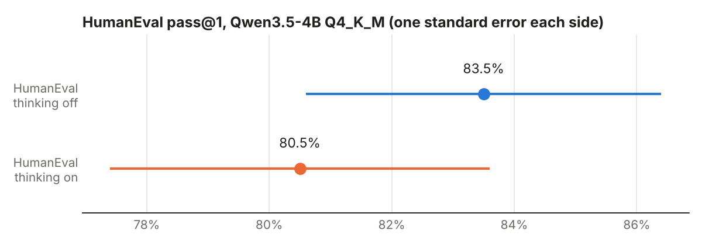

# Task 9: Research benchmarks (coding)

**Finding:** Qwen3.5-4B (Q4_K_M, on my RTX 5070) solved 137 of the 164 HumanEval problems with thinking off (83.5%, plus or minus 2.9) and 132 with thinking on (80.5%, plus or minus 3.1). The gap is within noise, but the reason for it is interesting: with thinking on, 25 replies were empty, because the model used up its 14,000-token limit while thinking and never wrote any code. Of the 139 problems where it did write code, 132 passed (95.0%). That is an upper bound, not a fair score, but it says the model is better at HumanEval when thinking if it gets enough room. The coding benchmarks themselves have moved a long way: HumanEval is near its ceiling and has weak tests, SWE-bench Verified is called saturated by its own makers' audits, and the benchmarks that still have room are SciCode and Terminal-Bench 2.0.

## The question

How is coding ability measured, from writing one function to fixing a real GitHub issue or working in a terminal? Which of these tests still tell models apart, and how does a 4-billion-parameter model on my own GPU do on the simplest one?

## What I did

1. **Ran HumanEval** (164 Python problems, each a function signature and docstring; the model writes the function, hidden unit tests check it) on Qwen3.5-4B Q4_K_M through lm-evaluation-harness against `llama-server`, with thinking off and on. The model is asked to reply with the finished function in one code block. `tasks/code_utils.py` pulls the code out of the reply, puts it after the original function header, appends HumanEval's own tests, and runs the result in a separate Python process with a 10 second limit. A problem counts as passed only if every test passes. A reply with no code block counts as wrong.
2. **Ran the model-written code in a throwaway Docker container.** `run_humaneval.py` starts `llama-server` on the PC and runs the whole harness inside a `python:3.12-slim` container that is deleted when it finishes. The container only shares the project folder. Sampling follows Qwen's recommended settings for each mode (see Task 8). Reply caps: 4,096 tokens with thinking off, 14,000 with thinking on.
3. **Researched six coding benchmarks** (HumanEval, MBPP, LiveCodeBench, SciCode, SWE-bench Verified, Terminal-Bench 2.0): [cards.md](cards.md), with the data in `data/benchmarks.csv` and sources in `data/sources.md`.
4. **Collected the coding scores** from the Qwen3 report, the Qwen3.5 model cards, the DeepSeek-V4 model card and the GLM-5 report into one table: [data/report_scores.csv](data/report_scores.csv) (a short version is below).
5. **Tried a SWE-bench Verified task myself** (`psf__requests-1142`). See the section below.
6. `analyze.py` made the summary tables and the chart. I ran the 59 failed programs once more to see why each failed: `results/humaneval_failures.csv`.

Hardware: Windows 11, RTX 5070 (12 GB), 8 GB RAM. llama.cpp b11630, lm-eval 0.4.13. Model: Qwen3.5-4B Q4_K_M.

## Results

### HumanEval

| Setting | Problems | Passed | pass@1 | Std. error | Replies with no code block | Pass rate among replies with code |
|---|---|---|---|---|---|---|
| Thinking off | 164 | 137 | 83.5% | 2.9 | 0 | 83.5% |
| Thinking on | 164 | 132 | 80.5% | 3.1 | 25 | 95.0% |

The thinking run took 107 minutes; the instant run took far less.



Per problem, the two runs agreed on most: 117 passed in both, 20 passed only with thinking off, 15 only with thinking on, and 12 failed in both ([results/humaneval_by_problem.csv](results/humaneval_by_problem.csv)).

**Why the 59 failures failed** ([results/humaneval_failures.csv](results/humaneval_failures.csv)):

| | Thinking off (27) | Thinking on (32) |
|---|---|---|
| Ran, but a test failed (wrong answer) | 22 | 6 |
| Empty reply, no code (ran out of tokens) | 0 | 25 |
| Other errors (cut-off code, a missing name, an empty-list crash, an endless loop, a bad import) | 5 | 1 |

Standard error is sqrt(p(1-p)/(n-1)).

## What it means

**Thinking didn't win here, because it ran out of room.** With thinking off, every reply had code and 22 of the 27 misses were plain wrong answers. With thinking on, the 7 that did write code and still failed are the real misses. The other 25 never got to write anything. The 95.0% on the 139 that finished is not a fair score, since the problems that make the model think longest are probably the hardest. It does suggest that with a bigger token limit the thinking run would beat the instant one. I didn't test that.

**The wrong answers were ordinary bugs, not odd formatting.** For example, the instant run's `fib` returned the wrong value because of an off-by-one in its loop, and its `maximum(arr, k)` broke when `k` was 0 (`sorted_arr[-0:]` returns the whole list). The two longest instant replies (12,000+ characters) ended in the middle of a string and stopped at the 4,096-token limit.

**83.5% is respectable for a 4-billion-parameter model, but HumanEval is a weak test.** GPT-4 scored 67.0% in 2023 (self-reported), and models passed 90% by 2024. The benchmark has been public since 2021 and its tests are thin: EvalPlus added about 80 times more tests and cut scores by up to 19 to 29 points across 26 models. So my 83.5% should be read as "writes simple functions well", not "codes at an 83.5% level".

**The way coding benchmarks are built has moved on.** HumanEval and MBPP ask for one function. LiveCodeBench uses new competition problems dated after each model's training cutoff, to avoid leaked test data. SciCode asks for real research code. SWE-bench Verified and Terminal-Bench 2.0 are agentic: the model works in a repository or a terminal and the result is checked afterwards. For the agentic ones, the score depends heavily on the scaffold (the agent loop and tools around the model), which is why scores for the same model differ between sources.

**SWE-bench Verified is called saturated by the people who ran it.** The best independent score I found is 97.0% (Claude Opus 5, Vals AI, 2026-09). OpenAI said in 2026-02 that it stopped reporting the benchmark: it audited the hardest problems and found 59.4% of 138 had flawed tests or descriptions, and that frontier models could reproduce the real fixes. Terminal-Bench 2.0 and SciCode still have room (see the cards). SciCode's public scores are also probably too low: a 2026 audit (SciCode-Verified, author-reported) found test defects that wrongly reject correct solutions.

### Coding scores from the reports

Self-reported unless noted, "Max"/"High" are the DeepSeek-V4 reasoning settings. The full table, with modes and sources, is [data/report_scores.csv](data/report_scores.csv). A dash means the report doesn't list that benchmark.

| Model | HumanEval | LiveCodeBench | SWE-bench Verified | Terminal-Bench 2.0 |
|---|---|---|---|---|
| **Qwen3.5-4B (my runs)** | **83.5% / 80.5%** (off / on) | not run | not run | not run |
| Qwen3-4B | | v5: 54.2 thinking, 21.3 non-thinking | | |
| Qwen3.5-4B (model card) | | v6: 55.8 | | |
| Qwen3.5-397B-A17B | | v6: 83.6 | 76.4 | 52.5 |
| DeepSeek-V4-Flash (Max) | | 91.6 | 79.0 | 56.9 |
| DeepSeek-V4-Pro (Max) | | 93.5 | 80.6 | 67.9 |
| GLM-5 | | | 77.8 | 56.2 |

Notes: LiveCodeBench versions differ (v5 and v6 use different problem windows; DeepSeek doesn't say which), so the numbers aren't directly comparable. SWE-bench and Terminal-Bench numbers depend on the scaffold (GLM-5: OpenHands and Terminus-2). DeepSeek-V4's HumanEval is listed only for its base models (69.5 Flash, 76.8 Pro), and the Qwen3 report lists HumanEval only inside an "EvalPlus" composite. I found no separate DeepSeek-V4 technical report, so I used its model card.

## SWE-bench Verified: `psf__requests-1142`

The task is in [swe-bench/task.md](swe-bench/task.md): a real bug in the `requests` library (GitHub issue #1051, fixed by PR #1142). Every request, even a plain GET with no body, was sent with `Content-Length: 0`, and some servers (amazon.com) answered 503 to that.

**The bug.** In `PreparedRequest.prepare_content_length` (`requests/models.py`), the first line wrote `Content-Length: 0` unconditionally. The lines after it replaced the value only when there was a body, so a bodyless GET kept the `0`.

**The fix** (1 line removed, 2 added): drop the unconditional line, and write `0` only when there is no body and the method is not GET or HEAD. See [swe-bench/answer.md](swe-bench/answer.md) for the exact patch.

**What I did.** I reproduced the bug in a throwaway `python:3.8` Docker container (the 2013 code does not run on newer Python). I did not find the fix on my own: I asked Claude to do the edit, and it gave me the reference fix, which I applied with a small script and checked. This is an honest record, not a solved benchmark. Before the edit, GET, HEAD and POST without data all printed `Content-Length: 0`. After it:

| Request | Headers before | Headers after |
|---|---|---|
| GET, no body | `Content-Length: 0` | none |
| HEAD, no body | `Content-Length: 0` | none |
| POST, no body | `Content-Length: 0` | `Content-Length: 0` |
| POST, `data='abc'` | `Content-Length: 3` | `Content-Length: 3` |

That matches what the official test `test_no_content_length` checks (GET and HEAD have no Content-Length). I did not run the full test suite.

**What it shows about the benchmark.** The task is small and well specified: one function, one clear symptom, a two-line fix. Real SWE-bench work for a model is harder than the fix itself: finding the function in a repository of thousands of lines, then deciding the right rule (GET and HEAD, but not POST). That search step is what the agentic scaffold has to do on its own.

## Problems hit

- **A harmless warning** about unauthenticated Hugging Face downloads showed up inside the container. It doesn't affect anything.
- **Thinking replies ran out of room.** This is the main result above; the limit was 14,000 tokens.
- **The old `requests` code doesn't run on Python 3.12**, which removed some names it uses, so the SWE-bench task runs in a Python 3.8 container.

## Caveats

- One small model, 4-bit compressed, one run per setting. Sampling is random, so another run would differ a little (in Task 8, two identical thinking runs differed by 1.4 points).
- 164 problems: the standard error is about 3 points, so 83.5% against 80.5% is not a real difference.
- This is my own prompt and code checker, not the harness's built-in HumanEval task, so scores aren't exactly comparable with published ones.
- The 95.0% on finished answers leaves out the problems it ran out of room on.
- Several "top scores" in the cards are self-reported by the model's maker or listed only by aggregator sites; the cards and `data/` mark which. Some benchmark details (affiliations, dates of first milestones) are marked unconfirmed in the data.
- I reran the 59 failed programs outside the container only to read the error type (see `results/humaneval_failures.csv`).

## Still open

- I did not solve the SWE-bench task independently; a model-agent run of it (the real benchmark setup) is not done.
- The reading: HF Evaluation Guidebook (code section), LiveBench introduction, and the coding tables of the Qwen3, DeepSeek-V4 and GLM-5 reports (the numbers are collected, the papers aren't read).

## Commands

```
cd C:\Users\brian\code\local-llm-lab\09-coding-benchmarks
# Docker Desktop must be running
..\.venv\Scripts\python run_humaneval.py --mode instant
..\.venv\Scripts\python run_humaneval.py --mode thinking
..\.venv\Scripts\python analyze.py
```
