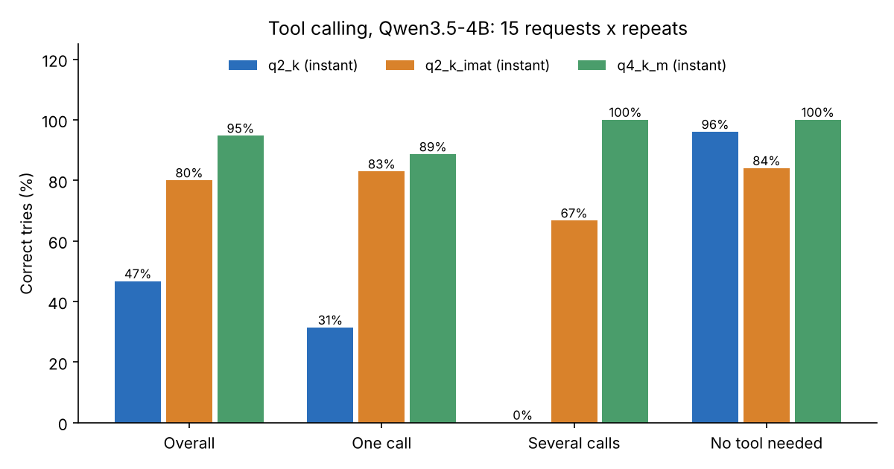

# Task 10: Agentic benchmarks and tool calling

**Finding:** I gave Qwen3.5-4B three tools (a calculator, a weather lookup and a file search) and 15 requests, five tries each, thinking off. The Q4_K_M file picked the right tool with the right arguments in 71 of 75 tries (94.7%). The plain Q2_K file got only 35 of 75 (46.7%), and it never once made two tool calls in one reply. Q2_K made with an importance matrix (same file size) got 60 of 75 (80.0%). So heavy compression breaks tool calling more than it breaks chat: Q2_K's perplexity in Task 3 was about 2.6 times the original's (25.5 against 9.7), and here its tool-calling score fell by half. The importance matrix recovered most of it, but introduced its own odd mistake: it copied the calculator's example expression into replies where no calculation was needed.

## The question

Models are now tested as agents that call tools and finish multi-step tasks. How are those tests built, and does my small 4-bit model call tools reliably? Does squeezing it down to 2 bits break tool calling more than it breaks plain chat?

## What I did

1. **Wrote six benchmark cards** (BFCL, tau-bench, GAIA, BrowseComp, MCP-Universe and MCPBench, Terminal-Bench 2.0): [cards.md](cards.md), with data in `data/benchmarks.csv`, sources in `data/sources.md` and scores quoted by the model reports in `data/report_scores.csv`.
2. **Wrote a 15-request tool-calling test** ([cases.py](cases.py)): 7 that need one call, 3 that need two calls at once, and 5 where no tool should be used (including a trap: "What's the weather like?" with no city, where the right move is to ask which city). The tools are fake: the model only chooses the tool and its arguments, and the script scores that choice. Nothing is really run.
3. **Ran it with llama-server** (`--jinja`, which turns on tool calling) on the RTX 5070, five tries per request, with Q4_K_M, Q2_K and the importance-matrix Q2_K ([run_tools.py](run_tools.py), analysis in [analyze.py](analyze.py)).

A try counts as **correct** only if the reply has exactly the expected calls with right arguments and no extras (for the "no tool" requests: no call at all). Arithmetic arguments are checked by working out the expression, so `1847*23` and `1,847 * 23` both count.

## Results

Qwen3.5-4B, thinking off, sampling temperature 0.7, 75 tries per file (15 requests x 5):

| File | Correct | Right tool | One call | Two calls | No tool needed | Median reply time |
|---|---|---|---|---|---|---|
| Q4_K_M | 71/75 (94.7%) | 94.7% | 88.6% | 100% | 100% | 0.50 s |
| Q2_K, importance matrix | 60/75 (80.0%) | 80.0% | 82.9% | 66.7% | 84.0% | 0.50 s |
| Q2_K | 35/75 (46.7%) | 52.0% | 31.4% | 0.0% | 96.0% | 0.49 s |



Per request (tries correct out of 5) is in `results/tools_by_case.csv`, and every wrong try with what the model did instead is in `results/tools_failures.csv`.

**Q2_K's 96% on "no tool needed" is not a good score.** It is high because Q2_K rarely calls any tool at all: it answered 25 of its 40 wrong tries in plain text instead of calling (for example it wrote "1847 * 23 = 42406", which is wrong; the real answer is 42,481).

### How each file failed

- **Q4_K_M (4 wrong tries):** all four were request 2, "What is 15% of 2,480?". It did the arithmetic itself and got the right answer (372), without calling the calculator. This is arguably a fine answer that my strict scoring marks wrong.
- **Q2_K (40 wrong tries):** 25 no call at all (often wrong answers like 42,406 or "$7.95"), 11 wrong or incomplete tool choices, and 4 right tool with wrong arguments (for example a search query of `</parameter>\n<parameter=folder>\nDocuments`, the tool-call markup leaking into the text, or the expression `"value"`). On "two calls" requests it made one call 9 times and none 6 times, never two.
- **Q2_K with importance matrix (15 wrong tries):** it always called some tool, and every one of the 15 wrong tries includes a calculator call that shouldn't be there. 8 of them are the same call, `12 * (3 + 4)`, which is the example written in the calculator's description, used for weather requests ("What's the weather in Tokyo and in London?" failed 5 of 5 this way). The rest: calculator calls on "How hot is it in Austin?" (4 of 5 tries) and on the Spain/Norway climate question that needs no tool (4 of 5 tries).

All arguments in all three runs parsed as valid JSON. The mistakes are in which tool and what content, not in broken formatting.

## What it means

**Squeezing to 2 bits hurts tool calling a lot more than it hurts chat.** Task 3 showed Q2_K still produced readable text. Here it fails on a job that needs precision: picking among tools, and filling in exact arguments. The importance matrix, which in Task 3 cut Q2_K's drift from the original about four times at the same file size, also lifts this score from 46.7% to 80.0%. But it is still below Q4_K_M, and the nature of the errors changed.

**Copying the example from a tool description is a real failure mode.** My calculator description includes the example `12 * (3 + 4)`. The Q2_K importance-matrix model repeated it eight times in the wrong place. If you write tools for small models, examples in tool descriptions can leak into their calls.

**Official tool-calling scores are measured differently.** Qwen's model card lists 50.3 on BFCL-V4 and 79.9 on TAU2-Bench for this model (self-reported). My 94.7% is not comparable: BFCL and tau2 use many more, much harder requests (multi-turn conversations, web search, a simulated customer), and mine are simple one-turn checks. What my test shows is that the basics work at Q4_K_M and not at Q2_K.

**What the six benchmarks measure:** BFCL checks tool calls directly (right function, right arguments), like my test but much bigger. tau-bench tests customer-service policy and consistency, GAIA general assistant questions, BrowseComp hard web research, MCP-Universe and MCPBench tools served over MCP (a standard plug for giving models tools), and Terminal-Bench 2.0 hard terminal work. In every case the score depends strongly on the scaffold (the loop and tools around the model): see the cards for specifics.

### Scores from the model reports

All self-reported by the model makers; a dash means the source doesn't list it.

| Model | BFCL-V4 | TAU2 | BrowseComp | Terminal-Bench 2.0 | MCP-Atlas |
|---|---|---|---|---|---|
| Qwen3.5-4B | 50.3 | 79.9 | - | - | - |
| Qwen3.5-397B-A17B | 72.9 | 86.7 | 78.6 (discard-all context) | 52.5 | - |
| GLM-5 | - | 89.7 | 75.9 (with its own context management) | 56.2 | 67.8 |
| DeepSeek-V4-Flash (Max) | - | - | 73.2 | 56.9 | 69.0 |
| DeepSeek-V4-Pro (Max) | - | - | 83.4 | 67.9 | 73.6 |

BrowseComp and Terminal-Bench numbers depend on the context strategy or harness, so they aren't directly comparable across rows. The full list with modes and sources is in `data/report_scores.csv`.

## Problems hit

- **The scoring is strict.** Q4_K_M's four "wrong" tries are correct answers given without the tool. A fairer test would accept either.
- **One example in my own tool description changed a result.** That's a finding, but it also means the test depends on how I wrote the tool text.

## Caveats

- One small model at three compression levels, thinking off, 5 tries per request. Sampling is random: a second run would differ a little, and 75 tries per file gives about plus or minus 5 points at 80%.
- 15 simple, single-turn requests with fake tools. This is much easier than BFCL's agentic or multi-turn tests and does not test what happens after a tool returns.
- I didn't test thinking mode, or other quantization levels (Q8_0, Q4_K_M with importance matrix).
- Several top scores in the cards are self-reported or taken from aggregator sites; the cards and `data/` mark which. The BFCL leaderboard table never loaded for the research, so its current top score is unconfirmed (two sources disagree).

## Still open

- Readings: HF Evaluation Guidebook ("2025 evaluations for useful models", tool-calling and assistant sections), the GLM-5 paper's agentic evaluation sections, the DeepSeek-V4 paper's agentic results, NVIDIA's Nemotron 3 Super introduction. The agent only pulled numbers from them; I haven't read them in full.
- A fairer version of the test that accepts correct answers without the tool, and a run with thinking on.

## Commands

From this folder, with the project's `.venv`:

```
..\.venv\Scripts\python run_tools.py --label q4_k_m --model C:\Users\brian\models\Qwen3.5-4B-Q4_K_M.gguf
..\.venv\Scripts\python run_tools.py --label q2_k --model C:\Users\brian\models\Qwen3.5-4B-Q2_K.gguf
..\.venv\Scripts\python run_tools.py --label q2_k_imat --model C:\Users\brian\models\Qwen3.5-4B-Q2_K-imat.gguf
..\.venv\Scripts\python analyze.py
```
`--repeats N` changes the tries per request (default 5), `--thinking` turns thinking on, `--url` uses a server you already started.
