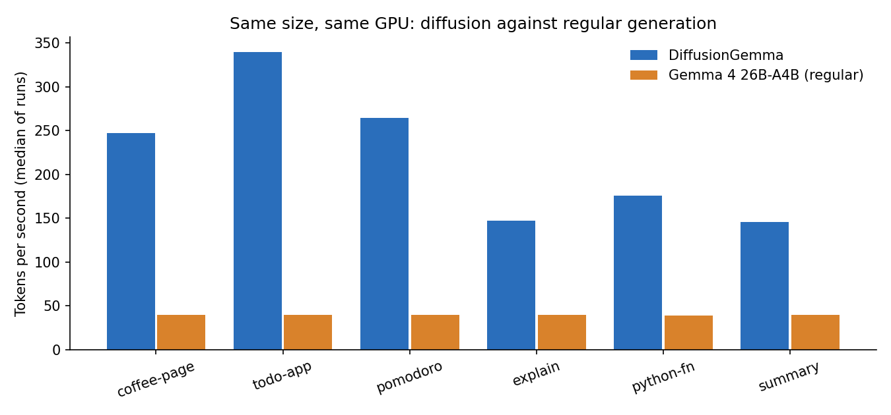
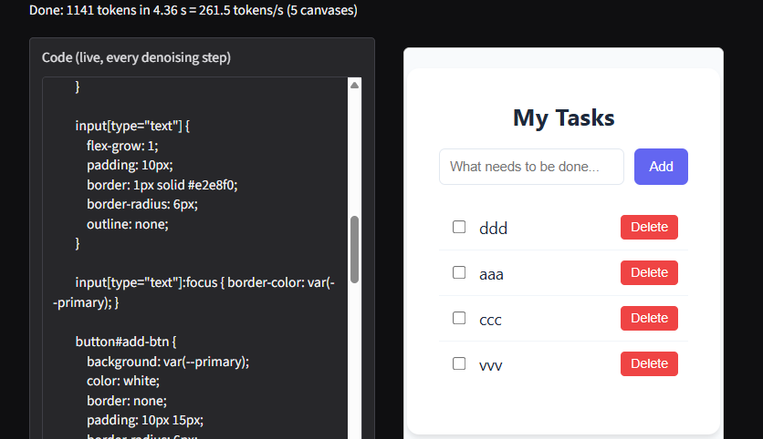

# Task 11: A diffusion website builder, and how fast diffusion really is

**Finding:** I rebuilt Google's "Gemma Diffusion Website Builder" demo around `google/diffusiongemma-26B-A4B-it` and compared its speed with the regular `google/gemma-4-26B-A4B-it` (same size, same GPU, both in bf16, one user). DiffusionGemma wrote **146 to 340 tokens per second**, against **39.3** for the regular model on every prompt: **3.7x faster on plain-text answers and 6.3x to 8.6x faster on web pages**. A whole 256-token canvas needed only 3 to 20 denoising steps (the limit is 48), and the model got 12 to 32 tokens out of each pass. The gain is bigger on code than on prose, because code is easier to guess early. I did not measure whether the diffusion answers are as good as the regular ones.

## The question

Can a diffusion language model, which writes 256 tokens at once and then refines them, really generate faster than a normal autoregressive model of the same size, and what does watching it work look like?

## What I did

1. **Built the demo app** ([app.py](app.py)): a prompt box, a code view that updates on every denoising step so you can watch each 256-token canvas fill in, a live preview of the page in a sandboxed iframe, a table with the denoising steps and seconds used by each canvas, and a status line with tokens per second.
2. **Wrote the streaming code** ([core.py](core.py)): a worker thread runs `model.generate(...)` with a streamer that receives the model's current best guess once per denoising step and the confirmed tokens once per canvas, and passes them to the app as frames.
3. **Wrote the speed test** ([benchmark.py](benchmark.py)): 6 prompts (3 web pages, 3 plain-text tasks), 3 timed runs each after a warm-up run, the median reported. Time is wall-clock for `model.generate()` with the GPU synchronised before and after. Tokens are counted up to the first end-of-sequence token.
4. **Ran it on Colab** with the notebook [11_diffusion_demo.ipynb](11_diffusion_demo.ipynb), because each model is about 50 GB and my PC's GPU has 12 GB.

The code was written by Claude. I ran every step on Colab and pasted back the output. Claude could not run the real model, so before my run the code was tested only with a fake model that follows the same streamer protocol ([tests/test_fake.py](tests/test_fake.py)). The details of the protocol came from reading the `transformers` source and Google's demo code, not from the model card alone.

## Setup

| | |
|---|---|
| GPU | NVIDIA RTX PRO 6000 Blackwell Server Edition, 97,887 MiB (what Colab calls the "G4" GPU) |
| Models | DiffusionGemma 26B-A4B-it (25.2B parameters, 3.8B active) and Gemma 4 26B-A4B-it, both bf16, about 50 GB each |
| Libraries | transformers 5.20.1, torch 2.11.0+cu130, accelerate 1.15.0, gradio 6.30.0 |
| Cost | about 5.4 Colab compute units for the whole session (100 before, 94.59 after; the G4 runs at about 8.9 units per hour) |
| Limit | 1,024 new tokens, thinking off, one request at a time |
| Sampling | DiffusionGemma: its default entropy-bounded sampler (up to 48 steps per canvas). Regular model: greedy decoding |

## Results

Median tokens per second of 3 runs. Speedup = diffusion divided by regular.

| Prompt | Type | Diffusion tok/s | Regular tok/s | Speedup | Diffusion tokens | Regular tokens | Steps per canvas | Tokens per forward pass |
|---|---|---|---|---|---|---|---|---|
| coffee-page | page | 247.3 | 39.3 | 6.3x | 1024 | 1024 | 13, 12, 10, 8 | 23.8 |
| todo-app | page | 339.8 | 39.3 | 8.6x | 1024 | 1024 | 7, 7, 6, 12 | 32.0 |
| pomodoro | page | 264.6 | 39.3 | 6.7x | 1024 | 1024 | 13, 10, 11, 8 | 24.4 |
| explain | chat | 147.1 | 39.3 | 3.7x | 622 | 702 | 13, 14, 12 | 17.3 |
| python-fn | chat | 175.3 | 39.2 | 4.5x | 485 | 557 | 12, 12, 3 | 19.0 |
| summary | chat | 145.6 | 39.3 | 3.7x | 526 | 447 | 20, 20 | 11.8 |

Individual runs (tok/s): coffee-page 235 / 304 / 247, todo-app 289 / 382 / 340, pomodoro 236 / 319 / 265, explain 122 / 156 / 147, python-fn 212 / 175 / 104, summary 160 / 131 / 146. The regular model varied by less than 0.4 tok/s between runs. All the raw numbers are in [results/bench_diffusion.json](results/bench_diffusion.json), [results/bench_regular.json](results/bench_regular.json) and [results/bench_summary.csv](results/bench_summary.csv).

The three page prompts hit the 1,024-token limit on both models, so those rows compare equal amounts of output. The chat rows do not: the two models wrote different answers of different lengths.

### The demo

I ran the app (public Gradio link) and asked for a to-do list. With the limit at 1,024 tokens the page was cut off in the middle of its script, so the buttons could not work, and the model had also left the closing bracket off the text box tag, so the Add button showed as plain text. With the limit at 2,048 the model wrote a complete page (1,141 tokens in 4.36 s, 261.5 tok/s, 5 canvases), and in the preview I could add tasks and see the checkboxes and Delete buttons. This is the page in the screenshot above. I only tried the to-do prompt for a full page, so this is one example, not a quality test.

## What it means

**Diffusion was several times faster here.** The regular model produces one token per forward pass. DiffusionGemma needed 3 to 20 passes for a whole 256-token canvas, which works out to 12 to 32 tokens per pass.

**Code is faster than prose.** The three page prompts got 24 to 32 tokens per pass and used 6 to 13 steps per canvas. The three chat prompts got 12 to 19 tokens per pass, and the summary needed 20 steps for each of its canvases. My explanation is that code is full of tokens that are easy to guess early (tags, braces, repeated patterns) while prose has more real choices. I did not test that directly.

**A canvas gets easier to finish as it goes.** In the coffee-page run the four canvases took 13, 12, 10 and 8 steps. The first canvas, with the most open choices, took the most.

**Watching it is the point.** In the app you can see a canvas start as a rough draft ("a generative model that that text text by by...") and get cleaned up over a few steps, which is a different picture from words appearing left to right.

## Problems hit

- **Colab's A100 was too small.** My Google AI Pro plan did not unlock the 80 GB A100 or the H100 in Colab; the A100 offered was the 40 GB one, which cannot hold a 50 GB model. After buying a pay-as-you-go pack of compute units I switched to the "G4" GPU, which has about 96 GB. It ran at about 8.9 compute units per hour.
- **Stray "thought" line.** Even with thinking turned off, every answer started with a bare `thought` line. I strip it in the display ([core.py](core.py)).
- **The second model did not fit on disk.** The disk was 113 GB and the first model's cache was 50 GB. The notebook step meant to delete it ran, but 50 GB was still in the Hugging Face cache afterwards (I do not know why), and the second download failed with "No space left on device". Deleting the whole Hugging Face cache folder freed 49 GB and the download then worked. The notebook now deletes the whole cache.
- **GPU memory was not freed.** After deleting the first model the GPU still showed 49.9 GB in use because something in the notebook still held a reference. Restarting the Colab session fixed it (0 MiB used). `core.free_gpu()` on its own does not free a model that is still referenced.
- **First-call overhead.** The very first short answer ran at 15.6 tok/s because of one-time setup. The speed test has a warm-up run so this does not affect the table.

## Caveats

- **Single user on one GPU.** Everything is one request at a time with plain `transformers` code. Google's own speed claim (more than 1,100 tok/s per user) is for an H100 with FP8 and a production setup, so my numbers are not comparable with it.
- **The regular model's 39.3 tok/s is probably slow because of the plain `transformers` loop, not the model.** Its active weights are about 3.8B parameters, and this GPU should allow far more than 39 tok/s on memory speed alone. I did not test a faster engine (vLLM, torch.compile), so the true gap against a well-optimised regular model could be smaller. This is my reading, not something I measured.
- **Different sampling.** The regular model used greedy decoding and DiffusionGemma its default sampler, so the outputs differ.
- **Answer quality was not measured.** I looked at one finished page. A fair comparison would need a benchmark such as the HumanEval setup from Task 9.
- **Small sample.** 3 runs per prompt and 6 prompts. DiffusionGemma's runs varied by up to a factor of two on one prompt (python-fn: 104 to 212 tok/s).
- **Thinking mode, other canvas lengths, batching and long prompts were not tested.**

## Still open

- **Readings:** the DiffusionGemma model card, the Hugging Face blog "Welcome Gemma 4", the Block Diffusion paper and Fast-dLLM.
- **Show the demo live to the group.** The app needs a rented big GPU, so it has to be started again from the notebook before the session (the download and loading took about 3 minutes for each model for me (161 and 164 s)).

## How to run it again

1. Open `11_diffusion_demo.ipynb` in Colab and choose a GPU with at least 80 GB (the "G4" or an A100 80GB).
2. Run the cells one at a time. Step 1b starts a timer that shuts the runtime down after 4 hours so it cannot burn compute units.
3. Upload `11-diffusion-demo.zip` in step 4, load the model in step 5, then use step 7 for the app and step 8 for the speed test.

The tests need no GPU: `python tests/test_fake.py` (with torch and gradio installed).
