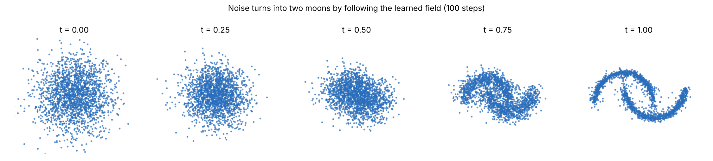
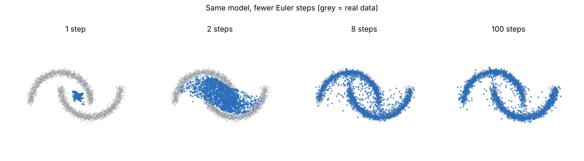

# Task 12: How diffusion works, from images to text

**Finding:** I trained a tiny flow-matching model (33,794 parameters, about 13 seconds on my PC) to turn random noise into a two-moons shape, and animated it. Following the learned arrows in 100 small steps lands the points on the shape: the average distance to the nearest real point is 0.026, against 0.019 for real data and 0.262 for pure noise. The same model with only one step collapses every point into a blob in the middle (0.378), with 2 steps it is 0.157, and with 8 steps it is 0.036. That is the central trade-off of diffusion: quality needs several small steps, and fewer steps means a blurrier answer. For text, the same idea works on discrete tokens instead of noisy numbers: either hidden (masked) words, or, in DiffusionGemma's case in Task 11, random tokens that get replaced as the model gains confidence.

## The question

What is diffusion, how does it generate things, why can't images' version be used directly for text, and how does a diffusion language model compare with a normal autoregressive one? (Task 11's demo builds on this.)

## What I did

1. **Trained a tiny flow-matching model on 2D points** ([flow_matching.py](flow_matching.py)): a 4-layer network that learns which direction to move a point at each moment, then used it to carry fresh noise to the shape.
2. **Measured quality against the number of steps** (1, 2, 4, 8, 16, 32 and 100 steps).
3. **Animated it** with the arrows of the field drawn behind the moving points: [results/flow_animation.gif](results/flow_animation.gif).
4. **Wrote the explainer** ([notes/explainer.md](notes/explainer.md)): continuous diffusion and flow matching, why text needs a discrete version, masked diffusion (MDLM, LLaDA), score entropy (SEDD), block diffusion, and how diffusion language models compare with autoregressive ones.
5. **Planned the 30-minute talk** ([notes/talk_outline.md](notes/talk_outline.md)), slide by slide, with the animation as its centre.

## How the model works

- Data: points on two interleaved moons. Noise: points from a round Gaussian blob.
- Pick a noise point and a data point and draw a straight line between them. At time t (0 to 1) the point is `(1-t) * noise + t * data`.
- Train a small network to predict the direction of travel along that line (data minus noise) from just the point's position and t.
- To generate, start from new noise and repeatedly step in the direction the network predicts (Euler steps), from t=0 to t=1.

## Results

Two moons, 2,000 generated points, 33,794-parameter network, 4,000 training steps, CPU, fixed random seeds (a test run on another machine printed identical numbers).

| Euler steps | Average distance to the shape (smaller is better) |
|---|---|
| 1 | 0.378 |
| 2 | 0.157 |
| 4 | 0.060 |
| 8 | 0.036 |
| 16 | 0.030 |
| 32 | 0.0275 |
| 100 | 0.0263 |
| real data (reference) | 0.0192 |
| pure noise (reference) | 0.262 |





Training loss (`results/flow_loss.csv`) falls from about 1.7 to 1.53 and then stays flat. It never gets near 0, and that is expected: at a given point and time, many different (noise, data) pairs could have led there, so the best the network can do is predict their average direction. That average direction is the learned "field".

## What it means

**One step gives the average.** With a single step, every point moves along the average direction at t=0, which is toward the middle of the data. All points collapse into one blob, the picture on the left of the second figure. More steps let the field bend toward the real shape as the points move. This is also why fast diffusion models use tricks (distillation, better solvers) to cut the number of steps.

**Diffusion generates all at once, then refines.** An autoregressive model commits to one word at a time, left to right. A diffusion model starts with a whole noisy (or masked) answer and improves all of it together over several rounds. The flow animation is the same idea in 2D.

**For text, noise has to become masks.** You cannot add a little Gaussian noise to a word. Masked diffusion replaces tokens with a mask symbol, and the model learns to fill them in (DiffusionGemma has no mask token: it starts from random tokens and re-noises uncertain ones). See [notes/explainer.md](notes/explainer.md) for MDLM, LLaDA, SEDD and block diffusion (the version DiffusionGemma uses).

## Problems hit

- Nothing broke. The only choice that mattered was using the CPU: the model is tiny, and the CPU gives the same numbers every run.

## Caveats

- This is a toy: 2D points and a 33,794-parameter network. It shows the mechanics (straight paths, a learned direction, Euler steps), not how an image or language model behaves at scale.
- The quality number is just the average distance to the nearest of 3,000 real points, so it rewards covering the shape closely but doesn't check that the points spread evenly across both moons.
- The explainer is from my own background knowledge of the papers, not from reading them for this task; the reading is still open (below). Treat the paper-by-paper claims as a first draft to check.

## Reading and slides (sources summarized and slides drafted by Claude, notes reviewed by me)
On 2026-10-17 Claude read the sources (MIT 6.S184 notes, the Cambridge blog, Raschka, MDLM, SEDD, LLaDA, Block Diffusion and Google's DiffusionGemma docs; notes in `notes/readings.md`), checked every paper-specific claim in the explainer (`notes/explainer_check.md`) and corrected it, then drafted an 18-slide, 30-minute talk: [slides](https://claude.ai/artifact/DAqXzCrTJ7tuKzAazFs5Pc) (private link; export to PDF for the portfolio). The biggest correction: DiffusionGemma has no mask token. It starts from random tokens. The pages were fetched through a summarizing tool, so equations and numbers should be rechecked before quoting. I have not watched the MIT lectures, and the slides have not been presented yet.

## Still open
- Skim the slides, present the talk before the Task 11 demo, and add a PDF export to this folder.
- Not confirmed in the readings: MIT notes section 7 (discrete diffusion), the SEDD masking special case, Fast-dLLM and Gemini Diffusion (not read), and the right arXiv ID for the diffusion language model survey.

## Commands

From this folder, with the project's `.venv`:

```
..\.venv\Scripts\python flow_matching.py
```
It writes everything in `results/`. About 30 seconds on a CPU.
